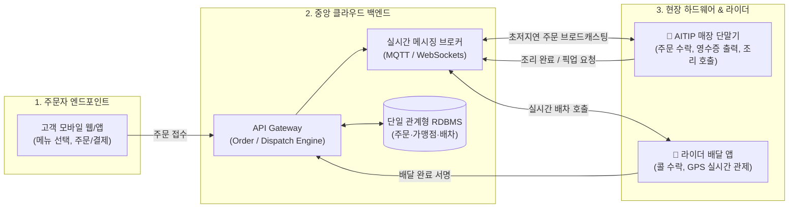

# 🚀 AITIP Platform (AITIP 단말기 연동 차세대 배달·주문 O2O 플랫폼)

> **시스템 규격**: STD-ENTERPRISE-MASTER-2026-V06 (전사 8대 식별자 체계 및 지자체·가맹점·단말기 완전 통합)  
> **개발 행동 강령**: `.agents/AGENTS.md` (사전 승인제, UID 무결성, ESM/API 계층 분리, 꼼수 절대 금지)  
> **프로젝트 위치**: `C:\Users\user\Desktop\aitip-platform`

---

## 📌 1. 프로젝트 정체성 및 핵심 미션

본 플랫폼은 **배달의민족 / 쿠팡이츠 스타일의 멀티 벤더(Multi-vendor) 주문·배달 생태계**를 기반으로, 현장의 **자체 하드웨어 `AITIP 단말기(가맹점/현장 IoT 단말기)`와 초저지연 실시간 프로토콜(WebSocket / MQTT / POS API)로 100% 직결**되는 차세대 O2O 통합 플랫폼입니다.

기존 복지부/지자체 돌봄망(WellRiskKeeper)의 **지자체(Org) ➔ 가맹점/사업단(Store/BU) ➔ 현장 배달원/라이더(Rider) ➔ 고객/수혜자(Customer)** 계층 체계를 그대로 승계하여, 민간 배달과 공공 복지 배달을 모두 아우를 수 있는 확장형 아키텍처를 지향합니다.

### 🌟 2대 핵심 공공 상생 실증 사업
1. **경로당 영양급식 통합 시스템**: 식재료·밀키트 간편 수·발주, 배송 라우팅, 입고 검수 확인, 지자체 보조금 전자 정산
2. **식품사막화 방지 O2O 시스템**: 단위농협 하나로마트 온라인 몰 연동, 상품/재고 관리, 피킹·포장(Pick & Pack), 개인·단체 공동구매, 노인일자리 배송원 연계
👉 *상세 사양서*: [`docs/경로당_영양급식_및_식품사막화_방지_사업_명세서.md`](./docs/경로당_영양급식_및_식품사막화_방지_사업_명세서.md)

---

## 🔑 2. 전사 표준 V06 8대 식별자 (UID) 체계 매핑

| 계층 | 코드명 | UID 규격 예시 | 설명 |
| :--- | :--- | :--- | :--- |
| **1계층** | **지자체/기관 (Org)** | `O-28-260-01` | 인천 서구청, 부평구청, 지자체 관할 본부 |
| **2계층** | **가맹점/사업단 (Store/BU)** | `B-28-260-01-ME01` | 입점 가맹점, 음식점, 반찬/도시락 제조소 |
| **3계층** | **AITIP 단말기 (Dev)** | `DEV-AITIP-A901` | 매장 카운터/주방에 설치된 IoT 터치 단말기 |
| **4계층** | **라이더/배달원 (Courier)** | `U-28-260-01-ME-001` | 현장 배달 라이더, 시니어 배달 참여자 |
| **5계층** | **고객/주문자 (Customer)** | `C-28-260-01-K1001` | 주문 고객, 돌봄 수혜 대상자 |
| **6계층** | **주문 원장 (Order)** | `ORD-20261106-0001` | 실시간 발생 주문 고유 식별자 |
| **7계층** | **배차/출동 (Dispatch)** | `DSP-20261106-0001` | 라이더 콜 배차 및 픽업/배달 트래킹 |
| **8계층** | **감사/결제 로그 (Audit)** | `L-6718E29A-1F4A` | 전자결제, POS 주문 정산 추적 로그 |

---

## 🏗️ 3. 3대 핵심 아키텍처 구조



---

## 📂 4. 디렉터리 구조 및 초기 세팅

```
aitip-platform/
├── .agents/
│   └── AGENTS.md                 # 프로젝트 개발 철칙 및 AI 행동 강령
├── docs/
│   └── 전사_다중_프로젝트_통합_플랫폼_표준_아키텍처_총람_v06.md
└── README.md                     # 본 프로젝트 마스터 명세서
```
