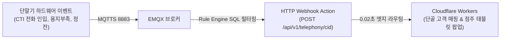

# 📟 [DOC-02] 가맹점 및 CTI 단말기 연동 상세기획서
**문서 식별자:** `AITIP-PILLAR02-MERCHANT-2026-V04`  
**버전:** `4.0.0 (Headless Gateway & Split Tablet UI)`  
**작성일자:** 2026-11-07  
**표준 런타임:** Cloudflare Workers (API/D1) + 외부 독립 MQTT 브로커 (EMQX v5 MQTTS 8883) + Durable Objects (WSS)  
**현장 하드웨어:** AITIP 헤드리스 CTI 컨트롤러 (Allwinner V3s) + 주방 거치형 태블릿/스마트폰 PWA  
**연관 문서:** `DOC-00`, `DOC-01`, `DOC-04`, `DOC-05`, `DOC-06`

---

## 1. 가맹점 기획 개요 및 이원화 아키텍처

본 기획서는 외식업 식당, 골목 상점, 단위농협 하나로마트 거점에 거치되는 **AITIP 엣지 시스템의 운영 규격(점주용 주문 접수 인터페이스, Fail-Open 전화 CTI, ESC/POS 영수증 이원화 인쇄, 원격 설정 관리)**을 정의합니다.

하드웨어 안정성과 비용 최적화를 위해 **"무화면 엣지 단말기(Headless Controller)"와 "점주 조작 화면(Tablet/Phone PWA)"을 물리적으로 이원화**하여 운영합니다.

```
┌──────────────────────────────────────────────────────────────────────────────────┐
│                   AITIP 가맹점 엣지 시스템 이원화 아키텍처                       │
├────────────────────────────────────────┬─────────────────────────────────────────┤
│ [1. 엣지 단말기 본체 (Headless)]       │ [2. 점주 조작 인터페이스 (Tablet/Phone)]│
├────────────────────────────────────────┼─────────────────────────────────────────┤
│ • Allwinner V3s 초경량 리눅스          │ • 주방 벽걸이 저가형 태블릿 또는 스마트폰│
│ • Fail-Open 기계식 LAN 바이패스 릴레이  │ • WebSocket(WSS) 기반 실시간 주문 팝업  │
│ • SIP B2BUA 인라인 통화 가로채기       │ • 원터치 조리시간 수락 ([15분], [25분]) │
│ • USB/시리얼 외장 영수증 프린터 제어   │ • 주방 소음 돌파 고주파 알림 차임벨     │
│ • 피에조 부저 90dB 호출음              │ • 당일 매출 및 영업일 마감 관리        │
└────────────────────────────────────────┴─────────────────────────────────────────┘
```

---

## 2. 점주 주문 접수 인터페이스 (Tablet/Phone PWA)

### 2.1 신규 주문 인입 시 팝업 및 원터치 수락
* **초고대비 모달 팝업**: 주문 인입 즉시 WSS 메시지를 수신하여 화면 전체가 깜빡이며 거대한 신규 주문 모달 표출.
* **조리 예상시간 원터치 수락 버튼**:
  `[ 15분 ]`, `[ 20분 ]`, `[ 25분 (기본) ]`, `[ 30분 ]`, `[ 45분 ]`, `[ 60분 ]`
* **점주 조리시간 터치 시 시스템 동작**:
  1. D1 DB 상태가 `COOKING`으로 전이되고 `cooking_minutes` 기록.
  2. 고객에게 카카오 알림톡으로 조리 시작 및 도착 예정 시간 통보.
  3. 라이더/배송원에게 픽업 요청 알림 발송.
  4. 단말기로 ESC/POS 인쇄 바이트 스트림 전송 ➔ 주방 전표 자동 절단 인쇄.

---

## 3. 주방 소음 돌파: 고출력 알림 사운드 엔진 (Web Audio API)

태블릿/스마트폰 브라우저의 기본 볼륨 한계를 극복하기 위해 Web Audio API의 디지털 게인 부스트를 적용합니다.

```javascript
// Web Audio API 디지털 게인 증폭 파이프라인
const audioCtx = new (window.AudioContext || window.webkitAudioContext)();
const gainNode = audioCtx.createGain();
gainNode.gain.setValueAtTime(2.0, audioCtx.currentTime); // 2.0배 디지털 증폭
gainNode.connect(audioCtx.destination);

// 주방 환풍기 소음을 뚫는 3단 고주파 딩동 차임 (1046Hz -> 1318Hz -> 1568Hz)
function playKitchenChime() {
  const osc = audioCtx.createOscillator();
  osc.type = "sine";
  osc.frequency.setValueAtTime(1046.5, audioCtx.currentTime);
  osc.frequency.setValueAtTime(1318.5, audioCtx.currentTime + 0.1);
  osc.frequency.setValueAtTime(1567.98, audioCtx.currentTime + 0.2);
  osc.connect(gainNode);
  osc.start();
  osc.stop(audioCtx.currentTime + 0.4);
}
```

---

## 4. 외장 열전사 프린터 제어 (TastyPrinter 듀얼 뷰 계승)

외장 영수증 프린터는 USB 2.0 또는 RS-232C로 단말기에 연결되며, Cloudflare Workers에서 생성된 ESC/POS 바이트 스트림을 수신하여 **주방용 전표와 카운터용 영수증을 엄격히 분리 인쇄**합니다.

```
┌─────────────────────────────────────────────────────────────────────────────────┐
│                     ESC/POS 2대 출력 뷰 완전 분리 인쇄 규격                     │
├────────────────────────────────────────┬────────────────────────────────────────┤
│ [1. 주방 조리용 대형 전표 (KITCHEN)]   │ [2. 카운터 및 배달원용 영수증 (COUNTER)]│
├────────────────────────────────────────┼────────────────────────────────────────┤
│ • 폰트 크기: `size='2x', bold=1`       │ • 폰트 크기: `size='normal'`           │
│ • 결제 금액 및 고객 개인정보 100% 배제 │ • 고객명, 안심번호, 배달 상세주소 표출 │
│ • 조리 메뉴명 및 옵션(optionsJson) 강조│ • 품목별 단가, 총 결제금액, 결제수단   │
│ • 조리 요청사항(specialRequest) 대형인쇄│ • 영수증 하단 원 단위 정산 내역        │
└────────────────────────────────────────┴────────────────────────────────────────┘
```

---

## 5. 전화 CTI 및 Fail-Open 바이패스 연동

1. **10초 무도구 설치**:
   * 인터넷 모뎀 라인을 단말기의 `LAN IN`에 꽂고, 동봉된 25cm 패치선으로 단말기 `LAN OUT`과 키폰 본체를 연결.
2. **Fail-Open 전화 보호 (정전 대책)**:
   * 단말기 전원 차단 시 기계식 DPDT 릴레이가 즉시 복귀하여 키폰 라인을 직결(Bypass)하므로, 단말기 전원이 꺼져도 키폰 통화는 정상 유지됩니다.
3. **디지털 ARS 안내 및 호전환**:
   * 전화 인입 시 인바운드 SIP INVITE 패킷을 가로채 발신번호를 식별합니다.
   * G.711u 음성으로 ARS 송출:
     🔊 *"카카오톡 간편 주문은 1번, 사장님 통화는 0번을 눌러주세요."*
   * 1번 선택 시 알림톡 주문 링크 발송 후 종료, 0번 선택 시 키폰으로 바이패스 연결.

---

## 6. MQTT 기반 단말기 원격 설정 관리 (Remote Config)

* 단말기 제어 토픽: `aitip/devices/{deviceId}/config` (QoS 1, **Retained = True**)
* 제어 항목:
  * `arsEnabled` (boolean): ARS 자동 응답 사용 여부
  * `buzzerVolume` (number): 본체 부저 음량 (0~100)
  * `printCopies` (object): 주방(`kitchen`) 및 카운터(`counter`) 인쇄 매수
  * `rebootTrigger` (boolean): 원격 펌웨어 재부팅
* **Retained Message 특성**: 단말기 전원이 꺼진 상태에서 설정을 변경하더라도, 단말기가 다시 부팅되는 즉시 브로커로부터 최신 설정을 수신하여 동기화합니다.

---

## 7. 외부 전용 MQTT 브로커(EMQX v5) 인프라 및 보안 격리 아키텍처

Cloudflare Workers의 L7(HTTP/WebSocket) 런타임 제약(Raw TCP 포트 수신 불가)을 극복하고, 수만 대의 단말기가 24시간 365일 초저전력·초저지연으로 상시 접속(Keep-Alive)할 수 있도록 **외부 독립 Linux VPS에 오픈소스 EMQX v5 브로커를 배포**하여 운영합니다.

```
┌──────────────────────────────────────────────────────────────────────────────────┐
│          Cloudflare Workers ↔ 외부 EMQX ↔ 가맹점 AITIP 단말기 통신 아키텍처      │
├────────────────────────┬─────────────────────────────┬───────────────────────────┤
│ [Cloudflare Workers]   │ [외부 전용 EMQX 브로커]     │ [가맹점 AITIP 단말기]     │
│ (글로벌 서버리스 엣지) │ (독립 Linux VPS / Docker)   │ (Allwinner V3s / Linux)   │
├────────────────────────┼─────────────────────────────┼───────────────────────────┤
│ • D1 주문 원자적 트랜잭션 │ • 포트: MQTTS 8883 (TLS 1.3)│ • paho-mqtt 초경량 클라이언트│
│ • EMQX REST API 호출   │ • 포트: REST API 18083      │ • 하드웨어 90dB 피에조 부저 │
│   (주문 10ms 푸시)     │ • 매장별 토픽 격리 ACL      │ • ESC/POS 프린터 USB 직결 │
│ • EMQX 웹훅 수신       │ • Rule Engine (CTI/LWT 웹훅)│ • SIP 전화선 통화 가로채기│
└────────────────────────┴─────────────────────────────┴───────────────────────────┘
```

### 7.1 브로커 서버 사양 및 포트 구성
* **호스팅 환경**: AWS Lightsail / 네이버클라우드 / 가비아 독립 Linux VPS (Ubuntu 24.04 LTS, Docker Compose 기반 EMQX v5 Community Edition).
* **개방 포트**:
  * `TCP 8883` (MQTTS): 단말기 보안 접속 포트 (Let's Encrypt TLS 1.3 인증서 적용).
  * `TCP 18083` (REST API & Dashboard): Cloudflare Workers IP 대역 및 운영자 VPN 전용 인가 포트 (방화벽 통제).

### 7.2 단말기 인증(Authentication) 및 엄격한 ACL 토픽 격리
타 매장의 주문 내역이나 CTI 전화 정보를 도청(Topic Snooping)하는 행위를 원천 차단하기 위해 **단말기별 고유 인증 및 토픽 권한(ACL)을 강제**합니다.
* **접속 인증 (Client Authentication)**:
  * `Username`: 단말기 고유 ID (`dev_...`, TypeID 규격)
  * `Password`: 단말기 설치 시 D1 `devices.secret_hash`와 대조되는 HMAC-SHA256 사전 공유 키.
* **토픽 접근 제어 목록 (ACL Rules)**:
  | 토픽 패턴 | 접근 권한 | 용도 |
  | :--- | :---: | :--- |
  | `aitip/stores/{storeId}/orders` | **Subscribe Only** | 해당 매장의 신규 주문 수신 전용 |
  | `aitip/devices/{deviceId}/config` | **Subscribe Only** | 해당 단말기의 원격 설정값 수신 전용 |
  | `aitip/devices/{deviceId}/telephony` | **Publish Only** | 인바운드 전화 CTI 발신번호 클라우드 보고 |
  | `aitip/devices/{deviceId}/status` | **Publish Only** | 단말기 온라인/오프라인 생존 하트비트 보고 |
  | `aitip/devices/{deviceId}/printer` | **Publish Only** | 영수증 프린터 종이 부족/커버 열림 텔레메트리 |

---

## 8. Cloudflare Workers → EMQX 주문 푸시 파이프라인 (REST API 규격)

고객이 온라인(PWA, 웹, ARS)으로 주문 결제를 완료하면, Cloudflare Workers는 D1에 주문을 기록한 직후 **0.01초(10ms) 만에 EMQX의 REST API를 호출하여 단말기로 실시간 푸시**합니다.

### 8.1 REST API 호출 명세
* **Endpoint**: `POST https://broker.aitip.kr:18083/api/v5/publish`
* **Headers**:
  ```http
  Authorization: Basic <EMQX_API_TOKEN_BASE64>
  Content-Type: application/json
  ```
* **Request Body**:
  ```json
  {
    "topic": "aitip/stores/str_01m6wzp8k8eh01/orders",
    "qos": 1,
    "retain": false,
    "payload": "{\"order_id\":\"ord_01m6wzpjfnfwh9j4zetc21ates\",\"display_seq\":105,\"fulfillment_type\":\"DELIVERY\",\"table_no\":null,\"total_amount\":24500,\"is_disposable_needed\":1,\"kitchen_memo\":\"단무지 많이 주세요\",\"items\":[{\"name\":\"순살반반치킨\",\"qty\":1,\"price\":19000,\"mods\":\"매운맛 2단계\"},{\"name\":\"치즈볼(5입)\",\"qty\":1,\"price\":5500,\"mods\":\"기본\"}]}"
  }
  ```

### 8.2 재시도 및 폴백(Fallback) 안전망
* **QoS 1 전달 보장**: 단말기가 수신 확인 패킷(`PUBACK`)을 보낼 때까지 브로커가 메시지를 재전송합니다.
* **3초 타임아웃 웹소켓 폴백**: 만약 3초 이내에 단말기 ACK가 확인되지 않으면, Workers는 백업 채널인 점주 스마트폰/태블릿 PWA 웹소켓(WSS)으로 알림을 교차 전송하고, 카카오 알림톡 긴급 알림을 발송합니다.

---

## 9. EMQX Rule Engine → Cloudflare Workers 텔레메트리 웹훅 규격

단말기에서 발생하는 하드웨어 이벤트(전화 인입, 전원 차단, 프린터 용지 부족)는 EMQX의 **고성능 내장 규칙 엔진(Rule Engine)**을 통해 Cloudflare Workers의 HTTP 엔드포인트로 실시간 포워딩(Webhook)됩니다.



### 9.1 CTI 전화 수신 가로채기 웹훅
* **EMQX Rule Engine SQL**:
  ```sql
  SELECT clientid as device_id, payload.caller_phone_hmac as hmac, payload.timestamp as ts
  FROM "aitip/devices/+/telephony"
  ```
* **Webhook Action**: `POST https://api.aitip.kr/api/v1/telephony/cid`
* **Workers 수신 시 동작**:
  1. HMAC을 기반으로 D1 `users` 및 `orders` 테이블에서 단골 고객 여부 및 과거 주문 내역을 0.01초 만에 조회.
  2. 점주 조작 태블릿 화면으로 `[단골 고객 홍길동님 전화 인입 - 최근 주문: 순살반반]` 팝업창을 즉시 표출.

---

## 10. 현장 무결성 방어 메커니즘 (LWT 오프라인 감지 & 용지 센서)

수천 대의 단말기가 전국 골목에 깔렸을 때 관리자가 현장에 가지 않고도 장애를 100% 원격 관제하기 위한 핵심 프로토콜입니다.

### 10.1 유언장(LWT: Last Will and Testament) 기반 실시간 오프라인 감지
* **문제점**: 시골 마트나 식당에서 직원이 청소 중 랜선을 뽑거나 공유기 코드를 건드려 단말기가 꺼진 경우, 시스템이 이를 모르면 배달 주문이 누락되는 치명적 사고 발생.
* **LWT 프로토콜**:
  1. 단말기가 EMQX에 최초 TCP 접속 시 **유언장(Will Message)**을 브로커에 등록:
     - Will Topic: `aitip/devices/{deviceId}/status`
     - Will Message: `{"status": "OFFLINE", "reason": "UNEXPECTED_DISCONNECT", "timestamp": 1731112233}`
     - Will QoS: 1, Will Retain: True
  2. 비정상적 전원 차단 또는 통신 두절 발생 시, EMQX가 즉시 Workers로 웹훅 전송.
  3. Cloudflare Workers가 점주 스마트폰으로 **"🚨 [긴급] 매장 단말기 전원/인터넷 연결이 끊어졌습니다. 공유기 코드를 확인하세요!"** 카카오 알림톡/SMS 자동 발송.

### 10.2 ESC/POS 프린터 실시간 용지 부족(Paper-Out) 텔레메트리
* **동작 원리**: 단말기 내부 데몬이 3초마다 외장 프린터에 실시간 상태 질의 명령(`DLE EOT 1` - Real-time status transmission)을 전송.
* **센서 감지 시 이벤트**:
  * 종이 잔량 5% 미만 또는 완전 소진 감지 시 즉시 토픽 발행: `aitip/devices/{deviceId}/printer` $	o$ `{"paper_status": "EMPTY"}`.
  * 점주 태블릿 상단에 **붉은색 경고등 점멸** 및 음성 경고 송출: 🔊 *"영수증 용지가 부족합니다. 롤 용지를 교체해 주세요."*
