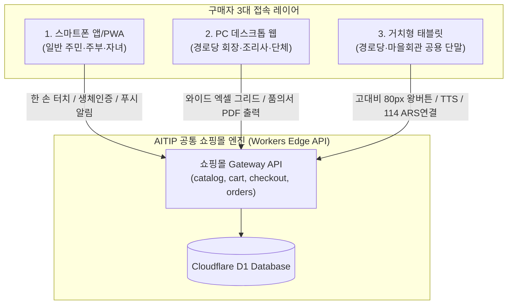
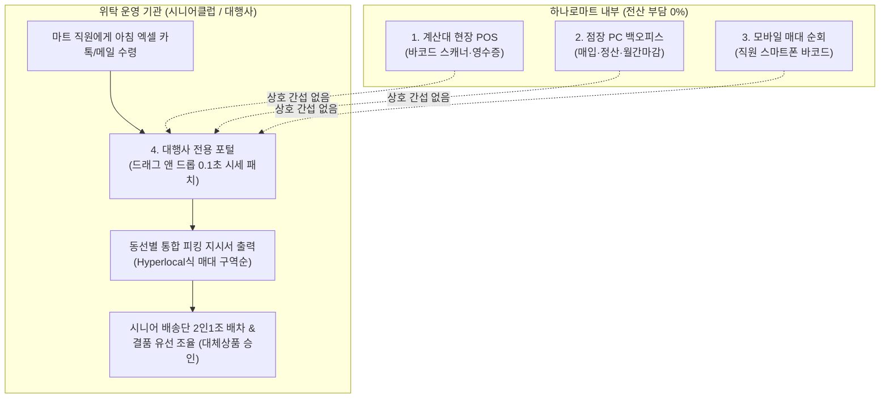

# 🛒 AITIP DOC-09: 하나로마트 다채널 접속 및 위탁 운영 상세 명세서
**문서 식별자:** `AITIP-SPEC-DOC-09-HANARO-CONSIGNMENT-2026-V01`  
**표준 제정일:** 2026-11-09  
**상태:** 승인 완료 (Approved & Implemented)  
**적용 대상:** 단위농협 하나로마트, 로컬푸드 직매장, 노인일자리 전담기관(시니어클럽), 지역 위탁 대행사, Cloudflare D1/Workers 백엔드

---

## 1. 🕊️ 핵심 신조 및 하나로마트 기초 인프라 설계 철학
> **"중앙회 전산 연동이라는 탁상공론의 환상을 버리고, 마트 직원이 툭 던져준 엑셀 1장을 살려내는 것이 진짜 현장 기술이다."**  
> 전국 농촌과 중소도시 단위농협 하나로마트는 고령의 적은 인력으로 매장을 지키고 있으며, 농협중앙회와의 실시간 ERP API 연동은 현실적으로 불가능합니다.  
> 마트 직원에게 복잡한 쇼핑몰 관리를 강요하는 것은 플랫폼의 오만입니다. 마트 직원은 평소처럼 포스에서 뽑은 엑셀을 우리 기관 대행사(시니어클럽)에 전달하고, **대행사 전담 매니저가 0.1초 만에 당일 시세를 반영하며, 시니어 배송단이 매대 동선별로 피킹·배송하는 완전한 위탁 상생 모델**을 구축합니다.

---

## 2. 🛒 구매자 3대 접속 환경 (Buyer Tri-Modal Architecture)

구매자의 연령대, 신체적 조건, 구매 목적에 맞춰 3대 독립 접속 레이어를 제공합니다.



### 2.1 스마트폰 모바일 앱 / PWA (일반 소비자)
- **주 사용자**: 일반 지역 주민, 1인 가구, 직장인, 어르신 부모님을 대신해 장보는 출가 자녀.
- **특징**:
  - 모바일 터치 최적화, 바텀 내비게이션(Bottom Nav), 한 손 조작 지원.
  - 배송 출발/도착 실시간 FCM 웹 푸시 및 생체 인증(지문/FaceID).
  - 당일 배송 타임슬롯(오전 10~12시 / 오후 14~17시) 선택.

### 2.2 PC 데스크톱 웹 포털 (경로당/복지관 대량 식자재)
- **주 사용자**: 경로당 총무·회장님, 공공어린이집·돌봄센터 조리사, 단체 급식 구매자.
- **특징**:
  - 1920x1080 와이드 화면 대응 엑셀형 다중 컬럼 그리드 (스크롤 딜레이 0초).
  - 카테고리별 다중 체크박스 일괄 장바구니 담기 및 과거 정기 발주 '1클릭 재주문' 복사.
  - **지자체 보조금 집행용 [구매 품의서 / 견적서 / 지출결의서] 원클릭 PDF 출력 및 국세청 전자세금계산서 연동**.

### 2.3 거치형 태블릿 / 키오스크 (어르신 맞춤형 공용 단말)
- **주 사용자**: 경로당 거치형 단말기, 마을회관 공용 정보판, 하나로마트 입구 간이 키오스크.
- **특징**:
  - **터치 영역 최소 80x80px 이상, 24pt 굵은 폰트의 고대비 UI** (노안/백내장 보정).
  - **음성 안내(TTS) 및 음성 검색(STT)**: *"대파랑 두부 어디 있노?"* 음성 인식 지원.
  - 화면 상단 **[114 ARS 전화주문 원터치 연결 버튼]** 탑재.
  - 장바구니 돋보기 모드 및 30초 무조작 시 자동 초기화(안전 절전).

---

## 3. 🏬 운영자 4대 관리 모드 (Operator Quad-Modal Architecture)

하나로마트와 위탁 운영 기관(시니어클럽)의 현장 실무에 맞춘 4대 역할 분담 체계입니다.



1. **계산대 현장 POS / 카운터 단말기**:
   - 오프라인 계산원용. 온라인 주문 영수증 자동 출력 및 오프라인 매장 판매 재고 실시간 차감.
2. **점장 백오피스 PC 웹**:
   - 매입처(B2B 농가/도매상) 공급가 관리, 세금계산서 승인, 월간 경영 손익 결산.
3. **모바일 매대 순회 웹/앱**:
   - 매장 직원이 매대를 돌며 스마트폰 카메라로 상품 바코드 스캔 $\to$ 즉시 품절 처리, 마감 할인 태그 부착.
4. **위탁 운영 관리자 포털 (Consignment Operator Portal - 시니어클럽/대행사 직원 전용)**:
   - **아침 엑셀 0.1초 인제스천**: 마트 직원이 보낸 포스 엑셀을 던지면 바코드 기준 0.3초 만에 신선 시세 인플레이스 갱신.
   - **원본 엑셀 감사 보존 (Audit Trail)**: 분쟁 방지용 원본 엑셀 R2 영구 저장.
   - **매대 동선별 통합 피킹 지시서(Batch Picking Sheet)**: 주문 10건을 묶어 1번 채소 $\to$ 2번 정육 $\to$ 3번 공산품 순 최적 동선 출력.
   - **시니어 배송단 배차 및 결품 유선 조율**: 매장 품절 시 구매자(경로당/주민)에게 즉시 전화하여 대체상품 원클릭 승인.

---

## 4. ⚡ 신선 농·수산물 당일 시세 엑셀 인제스천 파이프라인

새벽 경매와 날씨에 따라 매일 아침 가격이 요동치는 농·수산물 시세를 0.1초 만에 갱신하는 4단계 알고리즘:

```
[입력 엑셀] (마트 직원이 대행사 직원에게 카톡/이메일로 전달)
  ├── 8801043014854 (신라면 5개입): 4,200원 (변동 없음 -> 스킵)
  ├── 8809123456789 (흙대파 1단): 1,500원 -> 2,200원 (가격 인상 감지!)
  ├── 2000123065008 (한우양지 300g): 6,500원 -> 7,000원 (저울 바코드 가격 분리)
  └── PLU_105 (손두부 1모): 3,000원 (재고 0 -> 품절 전환 감지!)
       │
       ▼ [대행사 포털 0.1초 분석]
  [차분 리포트 팝업] "인상 1건, 품절 1건, 변동없음 2건 -> 반영하시겠습니까?"
       │
       ▼ [대행사 직원 원클릭 승인]
  [D1 Database] 기존 사진/표준명 100% 보존 상태에서 'price' 및 'daily_price_updated_at'만 핀포인트 갱신 완료!
```

---

## 5. 🏷️ 바코드 최우선(Barcode-First) 및 무바코드 예외 처리

### 5.1 바코드 최우선(Barcode-First, 80~90%)
- 마트 POS 엑셀에서 `barcode_sku`를 1순위 키로 수집.
- `shared_barcode_catalog`(코리안넷 2,000만 개 공공 DB)와 자동 조인하여 표준 상품명, 규격, 카테고리, 고화질 WebP 사진, 알레르기/원산지 0.1초 자동 완성.
- 시니어 배송원이 피킹할 때 스마트폰 카메라로 상품 바코드를 스캔하여 일치해야만 패킹 완료 (Scan to Pick) $\to$ **오배송 0%**.

### 5.2 바코드 미보유 농산물/로컬푸드 안전망 (10~20%)
- 흙대파, 시금치, 텃밭 농산물, 손두부 등 바코드가 없는 품목:
  - 마트 내부 단축키 코드(`pos_plu_code`, 예: `PLU_101`)로 관리.
  - **AITIP 신선 농축산물 200종 표준 WebP 이미지 라이브러리** 자동 매핑.
  - 마트 정육 저울 가변 바코드(`20`~`29` 프리픽스) 자동 분리 디코딩 (품목 5자리 + 가격 5자리).
  - 시니어클럽 매니저의 현장 **'3초 스마트폰 사진 스냅샷'** 지원.

---

## 6. 🗄️ Cloudflare D1 스키마 구현 내역

### 6.1 `users.role` 위탁 운영 및 피킹 권한 확장
```sql
ALTER TABLE users ADD CONSTRAINT chk_users_role CHECK (role IN (
    'SUPER_ADMIN', 'HQ_DEV_OPS', 'HQ_SALES_OPS', 'HQ_MERCHANT_OPS', 'HQ_FINANCE_OPS', 'HQ_LOGISTICS_OPS',
    'AGENCY_MASTER', 'AGENCY_MANAGER', 'AGENCY_OPERATOR', 'FIELD_ENGINEER', 'SALES_REP',
    'STORE_OWNER', 'MART_MANAGER', 'SENIOR_ORG_MANAGER', 'CONSIGNMENT_PICKER',
    'COMMERCIAL_RIDER', 'SENIOR_COURIER', 'COURIER', 'CUSTOMER'
));
```

### 6.2 `mart_suppliers` 위탁 운영 기관 및 유형
```sql
ALTER TABLE mart_suppliers ADD COLUMN consignment_org_id TEXT REFERENCES organizations(id)
    CONSTRAINT chk_mart_consignment_org CHECK (consignment_org_id IS NULL OR (length(consignment_org_id) = 30 AND consignment_org_id GLOB 'org_*'));
ALTER TABLE mart_suppliers ADD COLUMN consignment_type TEXT NOT NULL DEFAULT 'DIRECT'
    CONSTRAINT chk_mart_consignment_type CHECK (consignment_type IN ('DIRECT', 'CONSIGNED', 'HYBRID'));
```

### 6.3 `products` 매대 위치, PLU, 로컬푸드, 당일시세갱신
```sql
ALTER TABLE products ADD COLUMN shelf_location TEXT CONSTRAINT chk_products_shelf CHECK (shelf_location IS NULL OR length(shelf_location) <= 50);
ALTER TABLE products ADD COLUMN pos_plu_code TEXT CONSTRAINT chk_products_plu CHECK (pos_plu_code IS NULL OR length(pos_plu_code) <= 30);
ALTER TABLE products ADD COLUMN is_local_food INTEGER NOT NULL DEFAULT 0 CONSTRAINT chk_products_local_food CHECK (is_local_food IN (0, 1));
ALTER TABLE products ADD COLUMN daily_price_updated_at INTEGER CONSTRAINT chk_products_daily_price CHECK (daily_price_updated_at IS NULL OR daily_price_updated_at > 0);

CREATE INDEX idx_products_mart_barcode  ON products (mart_id, barcode_sku) WHERE barcode_sku IS NOT NULL;
CREATE INDEX idx_products_mart_location ON products (mart_id, shelf_location) WHERE shelf_location IS NOT NULL;
```

---

## 7. 🛡️ 무결성 검증 실측치 (198/198 PASS)

- `scripts/test_schema_integrity.py` Section 24에 위탁 대행사 매니저(`AGENCY_OPERATOR`), 피킹원(`CONSIGNMENT_PICKER`), 위탁 유형(`CONSIGNED`), 로컬푸드 플래그, 매대 위치(`shelf_location`), 바코드 및 매대 인덱스 쿼리 플랜 검증을 완료했습니다.
- **실행 결과: 198 / 198 전수 통과 (0 FAIL, 100% PASS)**.
