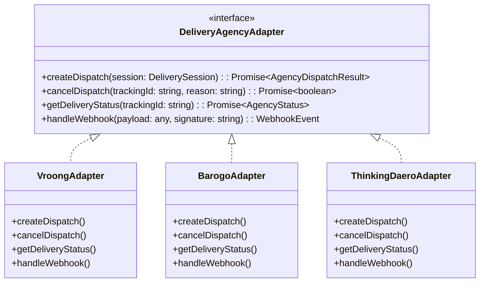
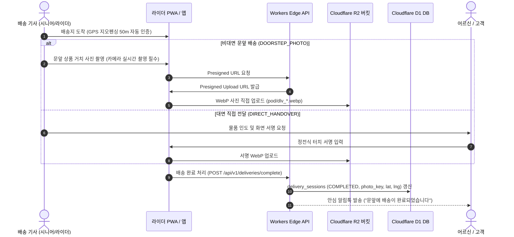

# 🚚 AITIP DOC-10: 배달대행사 외주 연동 및 쿼드러플 디스패칭·서지·ETA 상세 명세서
**문서 식별자:** `AITIP-SPEC-DOC-10-LOGISTICS-DISPATCH-2026-V02`  
**표준 제정일:** 2026-11-09  
**상태:** 승인 완료 (Approved & Implemented)  
**적용 대상:** 시니어클럽 배송단, 가맹점 계약 지역 배달대리점(지사/지점), 외주 배달대행사 본사(부릉, 바로고, 생각대로), 일반 배달 라이더, 요식업 가맹점, 하나로마트, Cloudflare Workers & D1

---

## 1. 🕊️ 핵심 신조 및 쿼드러플 디스패칭(Quadruple Dispatching) 설계 철학

> **"초근거리는 지역 어르신의 일자리와 가택 안부 확인(시니어 배송단)으로 온기를 더하고,  
> 일반 상권은 점주가 신뢰하는 지역 배달대리점(지사) 및 자체 라이더를 우선 존중하며,  
> 원거리와 악천후 피크타임은 전문 외주 배달대행사 API 연동으로 1초의 배송 공백도 허용하지 않는다."**

AITIP 배달 물류는 기존 독점 배달앱처럼 라이더를 착취하거나 자영업자에게 과도한 배달팁을 뜯어내는 구조가 아닙니다.  
1. 골목상권 가맹점과 하나로마트의 반경 1km 이내 초근거리 주문은 노인일자리 전담기관(시니어클럽)의 건강한 어르신들이 도보와 실버카트로 친환경·안심 배송을 전담합니다.  
2. 한국 요식업 자영업자의 70% 이상은 이미 동네의 **지역 배달대리점(바로고/생각대로/부릉 지사 또는 독립 연합 대리점)**과 직접 계약하여 선불 예치금을 넣고 친밀한 관계를 맺고 있습니다. AITIP은 이를 강제로 배제하지 않고 `LOCAL_AGENCY` 채널로 완벽히 품어 안습니다.  
3. 플랫폼 전담 라이더(`COMMERCIAL_RIDER`)가 중간 권역(1~3km)을 신속히 책임집니다.  
4. 점심·저녁 피크타임이나 폭우·폭설, 3km 이상의 원거리 주문으로 지역 배달망이 포화될 경우 **국내 3대 전문 외주 배달대행사(부릉, 바로고, 생각대로) 본사 API와 0.1초 만에 자동 연동**되어 주문 접수부터 배차, 실시간 배송 추적까지 끊김 없는 4중 물류 안전망을 완성합니다.

---

## 2. 🚦 쿼드러플 디스패칭 4단계 라우팅 파이프라인 (Quadruple Dispatching Pipeline)

배달 주문 발생 시, 주문 거리·무게·기상 상황·가맹점 계약 상태 및 기사 가용성을 실시간으로 판별하여 최적의 채널로 자동 분기합니다.

```mermaid
graph TD
    Order["주문 접수 및 결제 완료<br>(orders / ord_*)"] --> Eval{"배송 조건 평가<br>(거리, 무게, 날씨, 가맹점 계약)"}
    
    Eval -->|반경 1km 이내 & 5kg 이하<br>& 기상 양호| Stage1["1단계: 시니어 클럽 배송단<br>(SENIOR_COURIER / 도보·실버카트)"]
    Eval -->|가맹점 계약 대리점 배정<br>(1~3km 또는 5~15kg)| Stage2["2단계: 지역 배달대리점<br>(LOCAL_AGENCY / 지사·지점 연동)"]
    Eval -->|자체 플랫폼 순회 배정| Stage3["3단계: AITIP 전담 라이더<br>(COMMERCIAL_RIDER / 오토바이)"]
    Eval -->|3km 초과 또는 피크/폭우/폭설| Stage4["4단계: 중앙 외주 배달대행사 긴급호출<br>(OUTSOURCED_AGENCY / 3대사 본사 API)"]
    
    Stage1 -->|3분 내 미수락/콜 거부| Stage2
    Stage2 -->|3분 내 미배차/지사 콜 포화| Stage3
    Stage3 -->|5분 내 미배차/지연| Stage4
    
    Stage1 --> Delivery["배송 수행 및 완료 (delivery_sessions)"]
    Stage2 --> Delivery
    Stage3 --> Delivery
    Stage4 --> Delivery
```

### 2.1 1단계: 시니어 클럽 도보/실버카트 우선 배정 (`SENIOR_COURIER`)
- **대상 조건**: 배송 거리 $\le 1\text{km}$, 주문 상품 총중량 $\le 5\text{kg}$, 안전 보행 가능 기상.
- **배차 규칙**: 매장 인근 500m 이내 활동 중인 시니어 배송원 앱에 우선 푸시 알림 발송 (골든타임: 3분 대기).
- **부가 가치**: 배송 완료 시 독거노인 안부 확인(가택 대면 체크) 병행 지원.

### 2.2 2단계: 가맹점 계약 지역 배달대리점 (`LOCAL_AGENCY`)
- **대상 조건**: 가맹점이 기존에 계약 중인 지역 배달대리점(`partner_agencies.agency_type = 'DELIVERY_AGENCY'`)이 존재하고, 배송 거리 $1\text{km} \sim 3\text{km}$ 주문.
- **배차 규칙**: 가맹점 단말기 및 POS와 연동된 지역 지사 관제 시스템에 우선 콜 발송.
- **수수료 체계**: 대리점 관리비/지사 마진(`agency_commission_fee`, 200~400원)을 투명하게 분리 기록하여 점주-지사 간 정산 불신 원천 차단.

### 2.3 3단계: AITIP 플랫폼 전담 라이더 (`COMMERCIAL_RIDER`)
- **대상 조건**: 지역 대리점 미계약 점포이거나 지사 콜 포화 시, 플랫폼에 등록된 지역 순회 이륜차 라이더에게 자동 스마트 배차.

### 2.4 4단계: 중앙 외주 배달대행사 본사 긴급 호출 (`OUTSOURCED_AGENCY`)
- **대상 조건**: 배송 거리 $> 3\text{km}$, 피크타임(점심/저녁) 주문 폭주, 폭우·폭설 기상 악화, 또는 자체 라이더 5분 내 미배차 건.
- **배차 규칙**: 국내 3대 외주 대행사(부릉, 바로고, 생각대로) 중 가맹점이 설정한 본사 API를 즉시 호출하여 배차 위탁.

---

## 3. 🔌 국내 3대 외주 배달대행사 통합 연동 규격 (Agency Integration)

Cloudflare Workers 백엔드에서 3대 대행사의 서로 다른 통신 프로토콜을 단일화된 인터페이스(Adapter Pattern)로 추상화합니다.



### 3.1 3사 규격 매핑 및 엔드포인트 사양

| 항목 | 부릉 (VROONG / Mesh Korea) | 바로고 (BAROGO) | 생각대로 (THINKING_DAERO / 로지올) |
| :--- | :--- | :--- | :--- |
| **인증 방식** | Bearer JWT (API Key + Secret) | Bearer API Key | HMAC-SHA256 Secret Signature |
| **배차 요청** | `POST /api/v1/deliveries` | `POST /v1/orders` | `POST /api/external/v1/order/request` |
| **배차 취소** | `POST /api/v1/deliveries/{id}/cancel` | `PUT /v1/orders/{id}/cancel` | `POST /api/external/v1/order/cancel` |
| **상태 웹훅** | `POST /api/v1/webhooks/vroong` | `POST /api/v1/webhooks/barogo` | `POST /api/v1/webhooks/thinking-daero` |
| **기사 상태 코드** | `ASSIGNED`, `PICKED_UP`, `DELIVERED` | `ALLOCATED`, `PICKED_UP`, `COMPLETED` | `10(배차)`, `20(픽업)`, `30(완료)` |
| **AITIP 표준 상태** | `ASSIGNED` | `PICKED_UP` | `COMPLETED` / `FAILED` |

### 3.2 장애 대응 서킷 브레이커 및 멀티 페일오버 (Failover Policy)
1. **타임아웃 감지**: 대행사 API 호출 후 3.0초 이내 응답이 없을 경우 즉시 타임아웃 처리.
2. **선불 예치금 소진 감지**: 잔액 부족(`INSUFFICIENT_BALANCE`) 에러 수신 시 점주에게 긴급 알림(SMS/카톡) 발송.
3. **자동 페일오버(Fallback)**: 가맹점이 예비 대행사(예: 부릉 주 대행사, 바로고 예비 대행사)를 지정한 경우, 주 대행사 실패 시 1초 내 예비 대행사로 즉시 우회 재호출.

---

## 4. ⛈️ 동적 서지 요금(Surge Pricing) 산출 엔진

오픈소스 벤치마크(`swadkart/surgePricingController.js`, `hyperlocal/systemStore.ts`)를 바탕으로, 한국의 기상청 공공데이터와 골목상권 환경에 맞춘 완전한 배달비 계산 공식을 수립합니다.

$$\text{Total Delivery Fee} = \text{Base Fee} + \text{Distance Surge} + \text{Weather Surge} + \text{Peak Surge}$$

### 4.1 기본 배달비 및 거리 할증 (`base_delivery_fee`, `distance_surge_fee`)
- **기본 요금 (`base_delivery_fee`)**:
  - 기본 반경(1.0km 이내): 3,000원 (시니어 배송단 기본 2,500원).
- **거리 할증 (`distance_surge_fee`)**:
  - 1.0km 초과 시 500m당 500원 추가 (예: 2.2km = $3,000 + 1,500 = 4,500원$).
  - 도서산간 / 고지대 가맹점 별도 할증(500~1,000원) 가능.

### 4.2 기상 할증 (`weather_surge_fee`)
기상청 초단기실황 API(`UltraSrtNcst`)의 강수 형태(`PTY`) 및 기온(`T1H`)과 실시간 연동:
- **우천 (비)**: 1,000원 할증 ($PTY \in [1, 4]$)
- **폭설 (눈)**: 2,000원 할증 ($PTY \in [2, 3]$)
- **혹한 / 폭염**: 500원 할증 (기온 $\le -10^\circ\text{C}$ 또는 $\ge 35^\circ\text{C}$)

### 4.3 피크타임 할증 (`peak_surge_fee`)
- **점심 피크 (11:30 ~ 13:00)**: 500원
- **저녁 피크 (18:00 ~ 20:00)**: 500원
- **심야 피크 (23:00 ~ 04:00)**: 1,000원

---

## 5. ⏱️ 실시간 동적 도착 예정 시간(ETA) 산출 엔진

오픈소스 `swadkart/etaController.js`를 계승하여 배달 품질을 객관적으로 보장합니다.

$$\text{Estimated Delivery At} = \text{Current Time} + \text{Prep Time}(조리/피킹) + \text{Transit Time}(이동) + \text{Buffer}(안전마진)$$

### 5.1 항목별 산출 기준
1. **준비 시간 (`estimated_prep_minutes`)**:
   - 요식업 일반: 15분, 패스트푸드/분식: 10분, 찜/탕류/족발: 25분.
   - 하나로마트 피킹: 10건 미만 소량: 15분, 10건 이상 대량/공산품: 30분.
2. **이동 시간 (`estimated_transit_minutes`)**:
   - 운송 수단별 속도 모델링:
     - 도보/실버카트: $4.0\text{km/h}$ (시니어 어르신 보행 기준, 1km당 15분).
     - 자전거: $15.0\text{km/h}$ (1km당 4분).
     - 이륜차(오토바이): $30.0\text{km/h}$ (신호대기 포함 1km당 2.5분).
3. **안전 여유 버퍼 (`Buffer`)**:
   - 기상 악화 시 +5분, 엘리베이터 없는 4층 이상 고층 가구 +3분 자동 가산.

---

## 6. 📸 비대면 배달 증빙(PoD) 및 독거노인 안부 확인

오픈소스 `enatega/RiderApp`의 사진 증빙과 AITIP 고유의 독거노인 돌봄 안부 확인을 유기적으로 결합합니다.



### 6.1 배달 증빙 3대 유형 (`proof_type`)
1. `DOORSTEP_PHOTO` (문앞 보관): 비대면 기본값. 상품이 놓인 호수와 바닥이 함께 나오는 광각 사진 1장 필수 업로드.
2. `DIRECT_HANDOVER` (직접 대면 수령): 고객 터치 전자 서명 캡처.
3. `SECURITY_OFFICE` (경비실/관리실 위탁): 경비실 인수 대장 또는 보관함 사진 캡처.

### 6.2 안심 가택 안부 확인 (Care Check)
- 시니어 배송원이 경로당이나 독거 어르신 댁에 직접 배송할 때, 앱 화면에 **[어르신 안부 확인: 건강 양호 / 보살핌 필요 / 부재중]** 체크박스가 활성화됩니다.
- "보살핌 필요" 체크 시 관할 복지관 및 시니어클럽 전담 사회복지사 대시보드에 즉시 실시간 알림이 발송됩니다.

---

## 7. 💰 운송수단별 배달 기사 정산 분배 공식 (Driver Payout Breakdown)

약탈적 중개 수수료를 0%로 만들고, 배달료의 대부분을 땀 흘려 일하는 배송 노동자 및 지역 대리점에 투명하게 분배합니다.

$$\text{Driver Payout Amount} = \text{Total Delivery Fee} - \text{Agency Commission Fee} - \text{Platform Logistics Cut}$$

### 7.1 수수료 및 정산 상세 모델 (`driver_payout_amount`, `agency_commission_fee`, `platform_logistics_cut`)

| 운송 주체 | 총 배달비 예시 | 지역 대리점 수수료 (`agency_commission_fee`) | 플랫폼 운영 실비 (`platform_logistics_cut`) | 기사 실수령액 (`driver_payout_amount`) | 지급 및 정산 방식 |
| :--- | :--- | :--- | :--- | :--- | :--- |
| **시니어 배송단 (도보/카트)** | 3,000원 | **0원** (대리점 없음) | **200원** (서버 운영비 6.7%) | **2,800원 (93.3%)** | 시니어클럽 일자리 사업단 주간 정산 |
| **지역 배달대리점 (지사망)** | 4,000원 | **350원** (지사 관제/관리 마진) | **0원** (AITIP 플랫폼 수수료 0원) | **3,650원 (91.25%)** | 가맹점 예치금 차감 / 대리점 정산 원장 |
| **AITIP 자체 라이더** | 4,500원 | **0원** (대리점 없음) | **300원** (망 유지비 6.7%) | **4,200원 (93.3%)** | 익일 자동 정산 계좌 입금 |
| **중앙 외주 대행사 (부릉 등)** | 5,500원 | **0원** | **0원** (대행사 청구 금액 100% 전달) | **5,500원** (대행사 정책) | 외주 대행사 본사 예치금 자동 차감 |

---

## 8. 🗄️ Cloudflare D1 스키마 확장 내역 (Section 25)

```sql
CREATE TABLE delivery_sessions (
    id                             TEXT PRIMARY KEY
                                   CONSTRAINT chk_delivery_sessions_id CHECK (length(id) = 30 AND id GLOB 'dlv_[0-7]*' AND substr(id, 5) NOT GLOB '*[^0-9a-hjkmnp-tv-z]*'),
    order_id                       TEXT NOT NULL REFERENCES orders(id)
                                   CONSTRAINT chk_delivery_sessions_order_id CHECK (length(order_id) = 30 AND order_id GLOB 'ord_*'),
    worker_id                      TEXT REFERENCES workers(id)
                                   CONSTRAINT chk_delivery_sessions_worker_id CHECK (worker_id IS NULL OR (length(worker_id) = 30 AND worker_id GLOB 'wrk_*')),
    delivery_status                TEXT NOT NULL DEFAULT 'ASSIGNED'
                                   CONSTRAINT chk_delivery_sessions_status CHECK (delivery_status IN ('ASSIGNED', 'PICKED_UP', 'IN_TRANSIT', 'COMPLETED', 'FAILED')),
    delivery_channel               TEXT NOT NULL DEFAULT 'SENIOR_COURIER'
                                   CONSTRAINT chk_dlv_channel CHECK (delivery_channel IN ('SENIOR_COURIER', 'COMMERCIAL_RIDER', 'LOCAL_AGENCY', 'OUTSOURCED_AGENCY')),
    local_agency_id                TEXT REFERENCES partner_agencies(id)
                                   CONSTRAINT chk_dlv_local_agency CHECK (local_agency_id IS NULL OR (length(local_agency_id) = 30 AND local_agency_id GLOB 'agn_*')),
    local_agency_branch_name       TEXT
                                   CONSTRAINT chk_dlv_branch_name CHECK (local_agency_branch_name IS NULL OR length(local_agency_branch_name) <= 50),
    agency_commission_fee          INTEGER NOT NULL DEFAULT 0 CONSTRAINT chk_dlv_agency_fee CHECK (agency_commission_fee >= 0),
    outsourced_agency_name         TEXT
                                   CONSTRAINT chk_dlv_agency CHECK (outsourced_agency_name IS NULL OR outsourced_agency_name IN ('VROONG', 'BAROGO', 'THINKING_DAERO', 'OTHER')),
    outsourced_tracking_id         TEXT
                                   CONSTRAINT chk_dlv_track CHECK (outsourced_tracking_id IS NULL OR length(outsourced_tracking_id) <= 64),
    vehicle_type                   TEXT NOT NULL DEFAULT 'FOOT_WALK'
                                   CONSTRAINT chk_dlv_vehicle CHECK (vehicle_type IN ('FOOT_WALK', 'SILVER_CART', 'BICYCLE', 'MOTORCYCLE', 'VAN')),
    base_delivery_fee              INTEGER NOT NULL DEFAULT 0 CONSTRAINT chk_dlv_base_fee CHECK (base_delivery_fee >= 0),
    distance_surge_fee             INTEGER NOT NULL DEFAULT 0 CONSTRAINT chk_dlv_dist_fee CHECK (distance_surge_fee >= 0),
    weather_surge_fee              INTEGER NOT NULL DEFAULT 0 CONSTRAINT chk_dlv_weather_fee CHECK (weather_surge_fee >= 0),
    peak_surge_fee                 INTEGER NOT NULL DEFAULT 0 CONSTRAINT chk_dlv_peak_fee CHECK (peak_surge_fee >= 0),
    driver_payout_amount           INTEGER NOT NULL DEFAULT 0 CONSTRAINT chk_dlv_driver_payout CHECK (driver_payout_amount >= 0),
    platform_logistics_cut         INTEGER NOT NULL DEFAULT 0 CONSTRAINT chk_dlv_platform_cut CHECK (platform_logistics_cut >= 0),
    distance_meters                INTEGER CONSTRAINT chk_dlv_distance CHECK (distance_meters IS NULL OR distance_meters >= 0),
    estimated_prep_minutes         INTEGER CONSTRAINT chk_dlv_prep_min CHECK (estimated_prep_minutes IS NULL OR estimated_prep_minutes >= 0),
    estimated_transit_minutes      INTEGER CONSTRAINT chk_dlv_transit_min CHECK (estimated_transit_minutes IS NULL OR estimated_transit_minutes >= 0),
    estimated_delivery_at          INTEGER CONSTRAINT chk_dlv_eta CHECK (estimated_delivery_at IS NULL OR estimated_delivery_at > 0),
    pickup_at                      INTEGER,
    completed_at                   INTEGER,
    proof_type                     TEXT NOT NULL DEFAULT 'DOORSTEP_PHOTO'
                                   CONSTRAINT chk_dlv_proof_type CHECK (proof_type IN ('DOORSTEP_PHOTO', 'DIRECT_HANDOVER', 'SECURITY_OFFICE')),
    proof_photo_object_key         TEXT,   -- R2 비공개 객체 키
    recipient_signature_object_key TEXT,   -- 서명 이미지 객체 키
    proof_latitude                 REAL,
    proof_longitude                REAL,
    created_at                     INTEGER NOT NULL,
    updated_at                     INTEGER NOT NULL
);
CREATE INDEX idx_delivery_sessions_order   ON delivery_sessions (order_id);
CREATE INDEX idx_delivery_sessions_worker  ON delivery_sessions (worker_id);
CREATE INDEX idx_dlv_channel_status        ON delivery_sessions (delivery_channel, delivery_status);
CREATE INDEX idx_dlv_local_agency          ON delivery_sessions (local_agency_id) WHERE local_agency_id IS NOT NULL;
```

---

## 9. 🛡️ 무결성 검증 실측치 (278/278 PASS)

`scripts/test_schema_integrity.py` Section 20 및 Section 25에서 다음 항목에 대한 검증을 전수 완료하였습니다:
1. `partner_agencies.agency_type = 'DELIVERY_AGENCY'` (지역 배달대리점 지사) 등록 및 무효 타입 거부 통과.
2. 시니어 클럽 도보/실버카트 배달 등록 성공.
3. 부릉(`VROONG`) 이륜차 배달대행 등록 및 추적 ID 저장 성공.
4. 지역 배달대리점(`LOCAL_AGENCY`) 배송 세션 등록 성공 (지사 ID, 지점명, 지사 수수료).
5. 무효 배달 채널(`DRONE`), 무효 외주 대행사(`COUPANG_EATS`), 운송장 번호 초과(64자) 엄격 거부.
6. `local_agency_id` TypeID 접두사 규격(`agn_`) 검증 및 잘못된 접두사 거부.
7. `local_agency_branch_name` 50자 초과 거부.
8. `agency_commission_fee` 음수(-1) 거부.
9. 무효 운송수단(`HOVERBOARD`), 음수 기본료, 음수 기상 서지, 음수 기사 정산금 거부.
10. 음수 이동거리, 음수 이동시간, 0 이하 도착 예정 시간 거부.
11. 무효 배달 증빙 유형(`THROUGH_WINDOW`) 거부.
12. 배달 채널 및 상태 복합 인덱스(`idx_dlv_channel_status`), 지역 대리점 인덱스(`idx_dlv_local_agency`) 쿼리 플랜 작동 검증.

**실행 결과: 278 / 278 전수 통과 (0 FAIL, 100% PASS)**.
