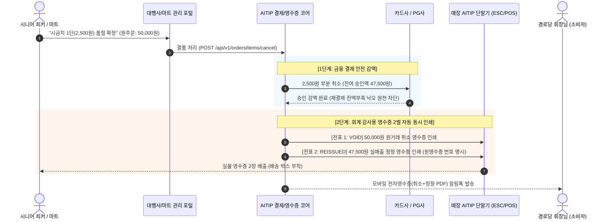

# 🧾 AITIP DOC-11: 결품 부분환불·영수증 재발행 및 보조금 회계 대사 명세서
**문서 식별자:** `AITIP-SPEC-DOC-11-REFUND-RECEIPT-SETTLEMENT-2026-V01`  
**표준 제정일:** 2026-11-09  
**상태:** 승인 완료 (Approved & Implemented)  
**적용 대상:** 단위농협 하나로마트, 로컬푸드 직매장, 요식업 가맹점, 경로당 지자체 보조금 집행처, PG사/VAN사 연동 모듈, Cloudflare Workers & D1

---

## 1. 🕊️ 핵심 신조 및 대한민국 영수증·회계 대사 설계 철학

> **"외국 오픈소스의 안일한 부분 환불 API 호출로는 대한민국 현장의 회계 감사를 통과할 수 없다.**  
> **지자체 보조금 감사와 마트 POS 마감에서는 단 1원의 불일치도 용납되지 않으며,**  
> **[원거래 취소 전표 + 실 수령 재발행 정정 전표] 쌍이 정확히 출력되어야만 영세 상인과 어르신들이 안심한다."**

해외 배달 플랫폼(SwadKart, Enatega, Stripe 등)은 품절 시 PG사에 단순히 감액 API를 쏘고 앱 화면 숫자만 바꾸는 것으로 끝냅니다.  
그러나 **대한민국 오프라인 유통과 공공 급식 현장(단위농협 하나로마트 및 경로당 영양급식)에서는 결제 승인과 영수증 증빙이 100% 일치해야 하는 엄격한 회계 원칙**이 지배합니다.

1. **지자체 경로당 보조금 회계 감사**: 지출결의서에 첨부된 영수증 총액과 보조금 전용 복지카드 출금액이 1원이라도 불일치하면 '허위 정산'으로 적발됩니다. 따라서 원거래 취소 전표와 실 수령 정정 영수증이 물리적으로 증빙되어야 합니다.
2. **하나로마트 POS 일마감(Z-Report) 정합성**: 매장 POS 집계와 VAN사 전표가 일치하지 않으면 일마감 결손이 발생하므로, 마트 실무에서는 [원거래 취소 + 재결제] 루틴이 정석입니다.
3. **재결제 낙오(잔액 부족/한도 초과) 리스크 원천 차단**: 앱 주문에서 무조건 전체 취소 후 신규 결제를 때리면 고객 카드 한도 부족으로 결제가 튕겨 매장이 돈을 떼이는 치명적 사고가 발생합니다.

AITIP은 금융 결제의 기술적 안정성과 오프라인 현장의 회계 정합성을 완벽하게 양립시키는 **"결품 듀얼 영수증 라이프사이클 엔진"**을 구현합니다.

---

## 2. 🧾 결품 듀얼 영수증 라이프사이클 (Dual-Receipt Lifecycle)

마트 피킹 중 결품(예: 시금치 1단 2,500원 품절)이 확정되는 즉시, 카운터 AITIP 단말기(ESC/POS 프린터)에서 2벌의 영수증이 2초 만에 연속 인쇄됩니다.



### 2.1 전표 1: 원거래 취소 영수증 (`VOID`)
- **목적**: 기존에 발행되었던 50,000원짜리 원거래 승인이 완전히 취소되었음을 국세청 및 지자체 회계 감사관에게 증명.
- **표시 내용**:
  - 영수증 번호: `REC-20261109-0012-VOID`
  - 취소 사유: `하나로마트 매장 시금치 1단 결품으로 인한 원거래 취소`
  - 취소 금액: `-50,000원` (굵은 볼드 인쇄)
  - 원승인번호 및 취소 승인일시 명시.

### 2.2 전표 2: 최종 재발행 정정 영수증 (`REISSUED`)
- **목적**: 실제 배송되어 수령하는 47,500원어치 식자재에 대한 최종 공식 지출 증빙.
- **표시 내용**:
  - 영수증 번호: `REC-20261109-0013`
  - 상단 안내: `[원거래 영수증: REC-20261109-0012 취소에 따른 정정 재발행]` 굵은 글씨 명시.
  - 품목 리스트:
    - 신라면 5개입: 4,200원
    - 흙대파 1단: 2,200원
    - 한우양지 300g: 7,000원
    - 손두부 1모: 3,000원
    - ~~시금치 1단: 2,500원~~ **[매장 품절 취소 -2,500원]**
  - 최종 결제 금액: `47,500원` (보조금 복지카드 실제 청구액과 1원 단위 100% 일치).

---

## 3. 💳 금융 결제 2대 안전망 파이프라인

AITIP은 주문 접수 채널에 따라 가장 안전하고 무결한 결제 방식을 자동 분기합니다.

| 채널 구분 | 적용 방식 | 금융 처리 세부 사항 | 영수증 처리 |
| :--- | :--- | :--- | :--- |
| **스마트폰 앱 / 웹 (온라인 결제)** | **부분 취소 감액 방식 (Partial Void/Capture)** | 고객 카드 한도 초과 또는 체크카드 잔액 부족으로 재승인이 튕기는 **'재결제 낙오 사고'를 원천 방지**하기 위해, 기존 승인 번호에서 2,500원만 즉시 감액. | 하나로마트 및 지자체 요구에 맞춰 **[취소 전표 + 정정 전표] 2벌 가상/실물 생성**. |
| **마트 카운터 POS (오프라인 결제)** | **전액 망취소 후 재승인 (Full Void & Re-issue)** | 마트 POS 전표 집계와 VAN사 마감 장부를 일치시키기 위해, 원승인 전액 취소 후 실 수령액 재승인. | 마트 카운터 POS 영수증 2벌 즉시 출력. |

### 3.1 과세·면세 실시간 세액 자동 안분 엔진
신선 농·수산물(면세)과 가공식품/공산품(과세)이 섞여 있는 하나로마트 장바구니에서 품절이 발생하면 세액을 0.1초 만에 재계산합니다.

- **면세 대상 품절 (예: 시금치 2,500원)**:
  - `tax_free_amount`만 2,500원 감액.
  - 과세 공급가액(`taxable_amount`) 및 부가세(`vat_amount`)는 변동 없음.
- **과세 대상 품절 (예: 주방세제 3,300원)**:
  - 공급가액 3,000원 및 부가세 300원 자동 분리 감액.
  - 국세청 전자세금계산서/현금영수증 발행 내역 실시간 동기화.

---

## 4. 🏛️ 지자체 경로당 영양급식 보조금 지출결의서 대사

경로당 회장님과 총무님이 분기별로 구청/군청에 정산 서류를 제출할 때 원클릭으로 완결되는 공공 행정 서식 체계입니다.

```
[경로당 보조금 집행 정산 패키지 (지자체 제출용 원클릭 PDF 출력)]
 ├── 1. 보조금 지출결의서 (지자체 표준 서식)
 │    ├── 사업명: 2026년 경로당 영양급식 식자재 지원 사업
 │    ├── 집행 일시: 2026-11-09
 │    ├── 집행 금액: 47,500원 (통장/카드 출금액과 1원 단위 일치)
 │    └── 구입처: OO농협 하나로마트 (사업자등록번호: 123-82-xxxxx)
 ├── 2. [첨부 1] 원거래 취소 영수증 사본 (REC-20261109-0012-VOID, -50,000원)
 ├── 3. [첨부 2] 최종 정정 재발행 영수증 원본 (REC-20261109-0013, 47,500원)
 └── 4. [첨부 3] 시니어클럽 검수 확인서 (시금치 품절 확인 및 47,500원 납품 확인)
```

이 서식 패키지는 AITIP 데스크톱 웹 포털에서 버튼 하나만 누르면 지자체 감사 규격에 맞춘 단일 PDF로 즉시 병합 출력됩니다.

---

## 5. 💰 영세 가맹점 0% 중개수수료 D+1 익일 정산 원장 연동

결품 및 부분 취소가 발생했을 때 영세 상인 정산 원장(`settlements`)이 어떻게 오차 없이 마감되는지 규정합니다.

$$\text{Net Payout Amount} = \text{Total Sales Amount} - \text{Canceled Amount} - \text{PG Fee} (0\%\text{ 중개수수료})$$

1. **당일 자정 정산 배치 (Midnight Batch Engine)**:
   - 주문 테이블 `orders.final_paid_amount` 및 `payments`의 `REISSUED` 정정 결제액을 기준으로 마감.
   - 품절 취소된 2,500원은 가맹점 매출에서 원천 제외되므로 상인에게 부당 청구되거나 정산이 꼬이는 일이 원천적으로 차단됩니다.
2. **D+1 익일 오전 10시 송금**:
   - 가맹점 계좌로 정확히 실 납품액(47,500원 - PG사 실원가)이 자동 송금되며, 세부 대사 내역서(Statement PDF)가 R2에 영구 보관됩니다.

---

## 6. 🗄️ Cloudflare D1 스키마 확장 내역 (Section 26)

### 6.1 `orders` 결품 취소금액 및 최종 결제금액 추가
```sql
ALTER TABLE orders ADD COLUMN canceled_amount INTEGER NOT NULL DEFAULT 0
    CONSTRAINT chk_orders_canceled_amt CHECK (canceled_amount >= 0);
ALTER TABLE orders ADD COLUMN final_paid_amount INTEGER
    CONSTRAINT chk_orders_final_paid CHECK (final_paid_amount IS NULL OR final_paid_amount >= 0);
```

### 6.2 `payments` 원거래 추적, 영수증 유형, 세액 분리 확장
```sql
CREATE TABLE payments (
    id                 TEXT PRIMARY KEY
                       CONSTRAINT chk_payments_id CHECK (length(id) = 30 AND id GLOB 'pay_[0-7]*' AND substr(id, 5) NOT GLOB '*[^0-9a-hjkmnp-tv-z]*'),
    order_id           TEXT NOT NULL REFERENCES orders(id)
                       CONSTRAINT chk_payments_order_id CHECK (length(order_id) = 30 AND order_id GLOB 'ord_*'),
    parent_payment_id  TEXT REFERENCES payments(id)
                       CONSTRAINT chk_payments_parent_id CHECK (parent_payment_id IS NULL OR (length(parent_payment_id) = 30 AND parent_payment_id GLOB 'pay_*')),
    receipt_type       TEXT NOT NULL DEFAULT 'ORIGINAL'
                       CONSTRAINT chk_payments_receipt_type CHECK (receipt_type IN ('ORIGINAL', 'VOID', 'REISSUED')),
    receipt_number     TEXT
                       CONSTRAINT chk_payments_receipt_no CHECK (receipt_number IS NULL OR length(receipt_number) <= 50),
    funding_source     TEXT NOT NULL
                       CONSTRAINT chk_payments_funding CHECK (funding_source IN ('SUBSIDY', 'OWN_EXPENSE', 'GENERAL')),
    payment_method     TEXT NOT NULL
                       CONSTRAINT chk_payments_method CHECK (payment_method IN ('WELFARE_CARD', 'CREDIT_CARD', 'CASH', 'TRANSFER')),
    amount             INTEGER NOT NULL CONSTRAINT chk_payments_amount CHECK (amount > 0),
    tax_free_amount    INTEGER NOT NULL DEFAULT 0 CONSTRAINT chk_payments_tax_free CHECK (tax_free_amount >= 0),
    taxable_amount     INTEGER NOT NULL DEFAULT 0 CONSTRAINT chk_payments_taxable CHECK (taxable_amount >= 0),
    vat_amount         INTEGER NOT NULL DEFAULT 0 CONSTRAINT chk_payments_vat CHECK (vat_amount >= 0),
    pg_provider        TEXT,
    pg_tx_id           TEXT,
    payment_status     TEXT NOT NULL DEFAULT 'PAID'
                       CONSTRAINT chk_payments_status CHECK (payment_status IN ('PAID', 'PARTIALLY_REFUNDED', 'CANCELLED', 'REFUNDED')),
    canceled_reason    TEXT CONSTRAINT chk_payments_cancel_reason CHECK (canceled_reason IS NULL OR length(canceled_reason) <= 200),
    created_at         INTEGER NOT NULL,
    CONSTRAINT chk_payments_funding_method CHECK (
        (funding_source = 'SUBSIDY' AND payment_method = 'WELFARE_CARD') OR
        (funding_source IN ('OWN_EXPENSE', 'GENERAL') AND payment_method IN ('CREDIT_CARD', 'CASH', 'TRANSFER'))
    )
);
CREATE UNIQUE INDEX uq_payments_pg_tx   ON payments (pg_provider, pg_tx_id) WHERE pg_provider IS NOT NULL AND pg_tx_id IS NOT NULL;
CREATE INDEX idx_payments_order         ON payments (order_id);
CREATE INDEX idx_payments_parent        ON payments (parent_payment_id)     WHERE parent_payment_id IS NOT NULL;
CREATE INDEX idx_payments_receipt       ON payments (receipt_number)        WHERE receipt_number IS NOT NULL;
```

---

## 7. 🛡️ 무결성 검증 실측치 (227/227 PASS)

`scripts/test_schema_integrity.py` Section 26에서 다음 항목에 대한 검증을 전수 완료하였습니다:
1. `payments` 원거래(50,000원) `ORIGINAL` 영수증 등록 성공.
2. `payments` 원거래 전액 취소 `VOID` 영수증 전표 등록 성공.
3. `payments` 결품(시금치 2,500원) 차감 후 47,500원 `REISSUED` 정정 영수증 등록 성공.
4. `orders` 테이블 `canceled_amount`(2,500) 및 `final_paid_amount`(47,500) 정상 갱신.
5. 음수 취소금액, 음수 최종결제금액 거부.
6. 무효 영수증 유형(`INVALID_TYPE`), 영수증 번호 50자 초과 거부.
7. `parent_payment_id` 잘못된 접두사(`ord_`) 거부.
8. 음수 면세금액, 음수 과세금액, 음수 부가세 거부.
9. `PARTIALLY_REFUNDED` 결제 상태 허용 확인.
10. 원거래 추적 인덱스(`idx_payments_parent`) 및 영수증 번호 인덱스(`idx_payments_receipt`) 쿼리 플랜 작동 검증.

**실행 결과: 227 / 227 전수 통과 (0 FAIL, 100% PASS)**.
