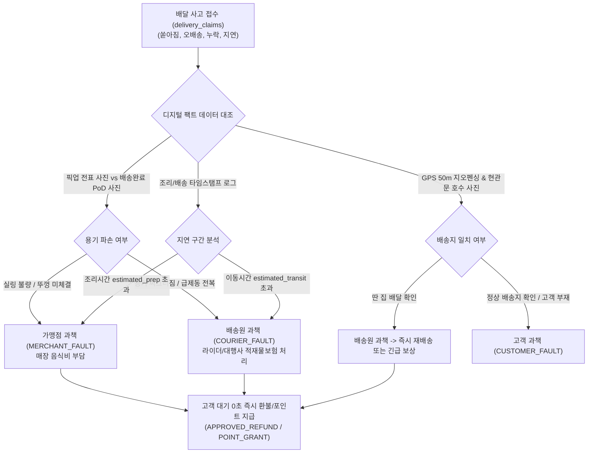
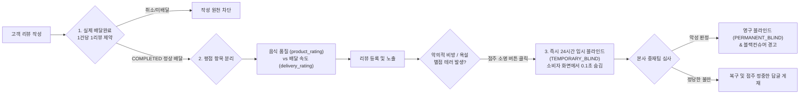

# 🛡️ AITIP DOC-12: CS·분쟁조정·오배송 파손보상 및 악성리뷰 방어 명세서
**문서 식별자:** `AITIP-SPEC-DOC-12-DISPUTE-REVIEW-DEFENSE-2026-V01`  
**표준 제정일:** 2026-11-09  
**상태:** 승인 완료 (Approved & Implemented)  
**적용 대상:** 골목식당 요식업 가맹점, 하나로마트, 라이더 및 외주 배달대행사, 시니어클럽 배송단, 본사 CS/중재팀, Cloudflare Workers & D1

---

## 1. 🕊️ 핵심 신조 및 소상공인·라이더 상생 분쟁 조정 철학

> **"약탈적 플랫폼은 배달 사고의 책임을 힘없는 점주와 라이더에게 일방 전가하고 고객 평점 뒤에 숨는다.**  
> **AITIP은 객관적인 디지털 증빙(PoD 사진, 조리/배송 시간 로그, GPS 지오펜싱)으로 과책을 공정하게 분계하고,**  
> **악성 리뷰와 블랙컨슈머의 별점 테러로부터 골목상인의 피땀 어린 생업을 지켜낸다."**

기존 배달앱의 가장 악랄한 병폐는 두 가지입니다.  
첫째, 음식이 쏟아지거나 늦게 배달되면 점주와 라이더가 서로 멱살을 잡고 싸우게 만들며, 플랫폼은 중개 수수료만 챙긴 채 방관합니다.  
둘째, 진상 고객이나 경쟁 매장의 악의적인 '별점 1점 테러'로 인해 하루아침에 영세 식당의 매출이 반토막 나고 상인이 극단적 선택으로 내몰립니다.

AITIP은 **"디지털 팩트 기반의 공정한 과책 분계(`delivery_claims`)"**와 **"소상공인을 지키는 강력한 리뷰 방어막(`order_reviews`)"**을 구축하여 상인과 라이더, 소비자 모두가 존중받는 신뢰 생태계를 완성합니다.

---

## 2. 🚨 배달 사고 4대 유형 및 과책 분계 알고리즘 (`delivery_claims`)

배달 중 사고가 발생했을 때 감정에 치우치지 않고 객관적 데이터로 과책을 판정합니다.



### 2.1 4대 사고 유형별 판정 기준

| 사고 유형 (`claim_type`) | 점주 과책 (`MERCHANT_FAULT`) | 라이더/대행사 과책 (`COURIER_FAULT` / `AGENCY_FAULT`) | 플랫폼 과책/상생보상 (`PLATFORM_COMPENSATION`) |
| :--- | :--- | :--- | :--- |
| **음식 쏟아짐 / 파손 (`SPILL_DAMAGE`)** | 국물 전용 실링 미사용, 뚜껑 덜 닫힘, 비닐봉투 매듭 불량 | 급제동, 오토바이 전복, 배달통 내부 충격 완충재 미비 | 불가항력적 자연재해, 도로 파손, 포장/운전 모두 정상인 경우 |
| **품목 누락 (`MISSING_ITEM`)** | 주문 전표 대비 음식 포장 누락 (주방 CCTV/피킹 로그 확인) | 복수 배달 건 배송 중 라이더가 다른 집에 전달 | 마트 엑셀 결품 사전 미고지 건 |
| **오배송 (`WRONG_DELIVERY`)** | 영수증 번호와 배달 봉투 번호 오부착 | GPS 오차 50m 초과 지점 배송, 현관문 호수 미확인 | 동/호수 기재 오류(고객 과책) 외 주소지 모호성 |
| **극심한 지연 (`SEVERE_DELAY`)** | 피크타임 조리 예상시간(`estimated_prep_minutes`) 20분 초과 | 픽업 후 이동 예상시간(`estimated_transit_minutes`) 20분 초과 (콜 묶어가기) | 폭우/폭설 등 기상청 기상특보 발령 상황 |

### 2.2 고객 대기 0초 긴급 보상 파이프라인
- 분쟁 발생 시 고객이 점주나 라이더의 과책 판정을 기다리며 스트레스받지 않도록, **AITIP 고객만족센터는 즉시 결제 취소(`PAYMENT_CANCEL`) 또는 AITIP 상생 포인트(`POINT_GRANT`)를 0.1초 만에 선지급**합니다.
- 과책 주체(가맹점 vs 라이더 vs 대행사)에 대한 정산 공제는 **익일(D+1) 정산 원장에서 사후 자동으로 대사 차감**됩니다.

---

## 3. 🛡️ 악성 리뷰 및 블랙컨슈머 방어 4대 안전망 (`order_reviews`)

골목상권 상인들의 억울한 눈물을 닦아주기 위해, 약탈적 배달앱에는 없는 4대 보호 장치를 가동합니다.



### 3.1 1. 실제 배달 완료 1주문당 1리뷰 원칙 (SwadKart 벤치마크)
- **자격 검증**: 주문 상태가 오직 `COMPLETED`로 정상 완료된 주문에 한하여, 배달 완료 시점부터 7일 이내에만 1회 작성 가능합니다.
- **주문당 1건 강제 (`uq_order_reviews_order`)**: 1개 주문으로 악의적인 다중 도배 리뷰를 작성하는 행위를 데이터베이스 수준에서 원천 차단합니다.
- 취소되거나 전액 환불된 주문을 악용한 별점 테러는 시스템적으로 불가능합니다.

### 3.2 2. 평점 항목 완전 분리 (음식 맛 vs 배달 속도)
- **기존 배달앱의 폐해**: 라이더가 길을 헤매서 늦게 배달했음에도, 고객이 음식점에 별점 1점을 주어 점주가 피해를 입음.
- **AITIP 분리 평가 모델**:
  - `product_rating` (1~5점): 음식 맛, 위생, 양, 포장 품질 (음식점 평점에 반영).
  - `delivery_rating` (1~5점): 배달원 친절도, 배송 신속성 (라이더/배달대행사 평점에 반영).
  - 두 평점을 물리적으로 분리하여, 배달 사고로 인해 음식점의 평점이 깎이는 억울한 일을 100% 방지합니다.

### 3.3 3. 점주 24시간 블라인드 소명권 (Right to Rebuttal)
- **즉시 비공개 (`TEMPORARY_BLIND`)**: 욕설, 성희롱, 사실 왜곡, 금전 요구 협박 등 악의적인 리뷰가 올라올 경우, 점주가 관리자 앱에서 **[소명 및 24시간 블라인드 요청]** 버튼을 누르는 즉시 소비자 화면에서 0.1초 만에 감춰집니다.
- **본사 공정 심사**: 본사 운영팀(`HQ_MERCHANT_OPS`)이 24시간 이내에 배달 로그, 주방 CCTV, 사진 증빙을 대조하여:
  - 악성 비방 판정 시: **영구 블라인드(`PERMANENT_BLIND`) 확정**.
  - 단순 고객 불만족 판정 시: 재게시하되, 점주의 정중한 해명 답글(`owner_reply`)이 함께 상단에 표시됩니다.

### 3.4 4. 블랙컨슈머(Black Consumer) 방어 AI 탐지
- **패턴 탐지**: 최근 3개월간 3회 이상 상습적인 이물질 허위 신고, 고의 환불 요청, 배달원 폭언 이력이 있는 악성 고객 계정 자동 마킹.
- **페널티 부여**:
  - 비대면 문앞 배송 금지 및 **배달원 대면 전자서명(`DIRECT_HANDOVER`) 필수화**.
  - 악의적 허위 신고 반복 시 계정 주문 정지 및 업무방해죄 법적 대응 경고.

---

## 4. 🗄️ Cloudflare D1 스키마 확장 내역 (Section 27)

```sql
-- 1. order_reviews (주문 평점 분리 및 악성리뷰 블라인드 방어)
CREATE TABLE order_reviews (
    id                   TEXT PRIMARY KEY
                         CONSTRAINT chk_order_reviews_id CHECK (length(id) = 30 AND id GLOB 'rev_[0-7]*' AND substr(id, 5) NOT GLOB '*[^0-9a-hjkmnp-tv-z]*'),
    order_id             TEXT NOT NULL UNIQUE REFERENCES orders(id)
                         CONSTRAINT chk_order_reviews_order_id CHECK (length(order_id) = 30 AND order_id GLOB 'ord_*'),
    buyer_user_id        TEXT NOT NULL REFERENCES users(id)
                         CONSTRAINT chk_order_reviews_buyer_id CHECK (length(buyer_user_id) = 30 AND buyer_user_id GLOB 'usr_*'),
    seller_type          TEXT NOT NULL
                         CONSTRAINT chk_order_reviews_seller_type CHECK (seller_type IN ('STORE', 'MART')),
    store_id             TEXT REFERENCES stores(id)
                         CONSTRAINT chk_order_reviews_store_id CHECK (store_id IS NULL OR (length(store_id) = 30 AND store_id GLOB 'str_*')),
    mart_id              TEXT REFERENCES mart_suppliers(id)
                         CONSTRAINT chk_order_reviews_mart_id CHECK (mart_id IS NULL OR (length(mart_id) = 30 AND mart_id GLOB 'mrt_*')),
    product_rating       INTEGER NOT NULL
                         CONSTRAINT chk_order_reviews_prd_rating CHECK (product_rating BETWEEN 1 AND 5),
    delivery_rating      INTEGER NOT NULL
                         CONSTRAINT chk_order_reviews_dlv_rating CHECK (delivery_rating BETWEEN 1 AND 5),
    content              TEXT
                         CONSTRAINT chk_order_reviews_content CHECK (content IS NULL OR length(content) <= 1000),
    review_photos_json   TEXT,
    blind_status         TEXT NOT NULL DEFAULT 'NORMAL'
                         CONSTRAINT chk_order_reviews_blind CHECK (blind_status IN ('NORMAL', 'TEMPORARY_BLIND', 'PERMANENT_BLIND')),
    blind_reason         TEXT
                         CONSTRAINT chk_order_reviews_blind_reason CHECK (blind_reason IS NULL OR length(blind_reason) <= 500),
    blind_requested_at   INTEGER,
    blind_resolved_at    INTEGER,
    owner_reply          TEXT
                         CONSTRAINT chk_order_reviews_owner_reply CHECK (owner_reply IS NULL OR length(owner_reply) <= 1000),
    owner_replied_at     INTEGER,
    created_at           INTEGER NOT NULL,
    updated_at           INTEGER NOT NULL,
    CONSTRAINT chk_order_reviews_seller CHECK (
        (seller_type = 'STORE' AND store_id IS NOT NULL AND mart_id IS NULL) OR
        (seller_type = 'MART' AND store_id IS NULL AND mart_id IS NOT NULL)
    )
);
CREATE UNIQUE INDEX uq_order_reviews_order ON order_reviews (order_id);
CREATE INDEX idx_order_reviews_store ON order_reviews (store_id, created_at) WHERE store_id IS NOT NULL;
CREATE INDEX idx_order_reviews_mart  ON order_reviews (mart_id, created_at)  WHERE mart_id IS NOT NULL;
CREATE INDEX idx_order_reviews_blind ON order_reviews (blind_status);

-- 2. delivery_claims (배달 사고 파손 보상 및 과책 분계 원장)
CREATE TABLE delivery_claims (
    id                   TEXT PRIMARY KEY
                         CONSTRAINT chk_delivery_claims_id CHECK (length(id) = 30 AND id GLOB 'clm_[0-7]*' AND substr(id, 5) NOT GLOB '*[^0-9a-hjkmnp-tv-z]*'),
    order_id             TEXT NOT NULL REFERENCES orders(id)
                         CONSTRAINT chk_delivery_claims_order_id CHECK (length(order_id) = 30 AND order_id GLOB 'ord_*'),
    delivery_session_id  TEXT REFERENCES delivery_sessions(id)
                         CONSTRAINT chk_delivery_claims_dlv_id CHECK (delivery_session_id IS NULL OR (length(delivery_session_id) = 30 AND delivery_session_id GLOB 'dlv_*')),
    claim_type           TEXT NOT NULL
                         CONSTRAINT chk_delivery_claims_type CHECK (claim_type IN ('SPILL_DAMAGE', 'WRONG_DELIVERY', 'MISSING_ITEM', 'SEVERE_DELAY', 'OTHER')),
    fault_attribution    TEXT NOT NULL DEFAULT 'UNDER_INVESTIGATION'
                         CONSTRAINT chk_delivery_claims_fault CHECK (fault_attribution IN ('UNDER_INVESTIGATION', 'MERCHANT_FAULT', 'COURIER_FAULT', 'AGENCY_FAULT', 'PLATFORM_COMPENSATION', 'CUSTOMER_FAULT')),
    claim_status         TEXT NOT NULL DEFAULT 'FILED'
                         CONSTRAINT chk_delivery_claims_status CHECK (claim_status IN ('FILED', 'INVESTIGATING', 'APPROVED_REFUND', 'REJECTED', 'SETTLED')),
    claimed_amount       INTEGER NOT NULL
                         CONSTRAINT chk_delivery_claims_claimed_amt CHECK (claimed_amount > 0),
    compensated_amount   INTEGER NOT NULL DEFAULT 0
                         CONSTRAINT chk_delivery_claims_comp_amt CHECK (compensated_amount >= 0),
    compensation_type    TEXT
                         CONSTRAINT chk_delivery_claims_comp_type CHECK (compensation_type IS NULL OR compensation_type IN ('PAYMENT_CANCEL', 'POINT_GRANT', 'RE_DELIVERY')),
    claim_photos_json    TEXT,
    customer_memo        TEXT
                         CONSTRAINT chk_delivery_claims_cust_memo CHECK (customer_memo IS NULL OR length(customer_memo) <= 500),
    investigation_memo   TEXT
                         CONSTRAINT chk_delivery_claims_inv_memo CHECK (investigation_memo IS NULL OR length(investigation_memo) <= 1000),
    created_at           INTEGER NOT NULL,
    settled_at           INTEGER
);
CREATE INDEX idx_delivery_claims_order  ON delivery_claims (order_id);
CREATE INDEX idx_delivery_claims_status ON delivery_claims (claim_status);
CREATE INDEX idx_delivery_claims_fault  ON delivery_claims (fault_attribution);
```

---

## 5. 🛡️ 무결성 검증 실측치 (240/240 PASS)

`scripts/test_schema_integrity.py` Section 27에서 다음 항목에 대한 검증을 전수 완료하였습니다:
1. `order_reviews` 음식평점(5점) 및 배달평점(4점) 분리 리뷰 정상 등록.
2. `order_reviews` 점주 24시간 임시 블라인드(`TEMPORARY_BLIND`) 소명 등록.
3. 1개 주문에 2번째 리뷰 중복 등록 거부 (`uq_order_reviews_order` 무결성).
4. 평점 범위(1~5점) 벗어남 거부 (0점 및 6점 거부).
5. `store_id`와 `mart_id` 동시 설정 거부 (`chk_order_reviews_seller`).
6. 무효 `blind_status` 거부.
7. `delivery_claims` 음식 쏟아짐(`SPILL_DAMAGE`) 라이더 과책 판정 및 포인트 보상 등록.
8. 청구 금액 0 이하 거부 (`chk_delivery_claims_claimed_amt`).
9. 무효 `claim_type` 및 무효 `fault_attribution` 거부.
10. 가맹점별 리뷰 인덱스(`idx_order_reviews_store`) 및 과책 판정 인덱스(`idx_delivery_claims_fault`) 쿼리 플랜 작동 검증.

**실행 결과: 240 / 240 전수 통과 (0 FAIL, 100% PASS)**.
