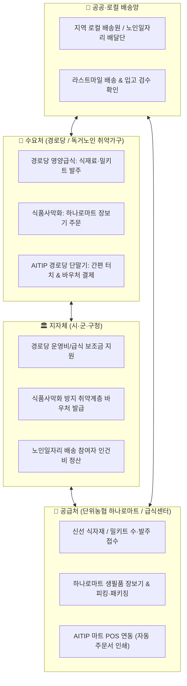
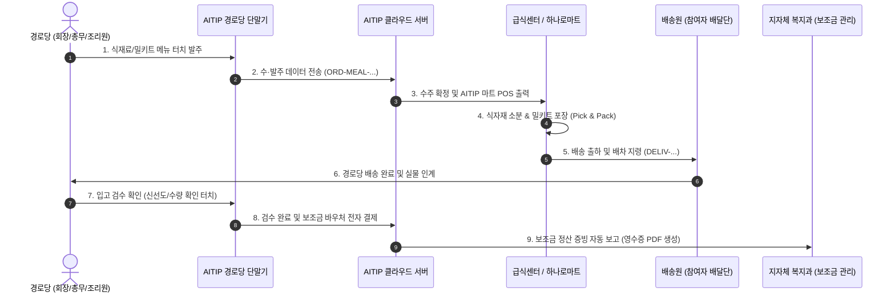

# 🌾 경로당 영양급식 및 식품사막화 방지 통합 O2O 사업 명세서

> **문서 번호**: AITIP-SPEC-MEAL-DESERT-2026-V01  
> **시스템 규격**: STD-ENTERPRISE-MASTER-2026-V06 (지자체·단위농협·경로당·단말기 완전 통합)  
> **보안 거버넌스**: `.agents/AGENTS.md` (사전 승인제, UID 무결성, 100% 완전 가명화, 보조금 결제 투명성)  
> **프로젝트 위치**: `C:\Users\user\Desktop\aitip-platform\docs`

---

## 📌 1. 사업 개요 및 배경

본 사업은 단순한 상업용 배달앱(치킨·피자 등)의 한계를 넘어, **지자체(보조금/행정) + 단위농협 하나로마트(식자재/생필품) + 경로당 및 취약가구(수요처) + AITIP 스마트 단말기(IoT 거점)**를 유기적으로 결합한 **대한민국 최초의 공공 상생형 배달·수발주 O2O 플랫폼**을 구축하는 것을 목표로 합니다.



---

## 🍱 2. [트랙 1] 경로당 영양급식 수·발주·배송·결제 통합 워크플로우

경로당 주 5일 점심식사 국정과제 및 지자체 영양급식 지원 정책에 발맞추어, 경로당 회장·총무·조리도우미 어르신이 스마트폰이나 **경로당 비치용 `AITIP 단말기`의 큰 글씨 터치 한 번으로 양질의 식재료와 맞춤 밀키트를 수·발주하고 보조금으로 자동 정산**하는 시스템입니다.

### 1) 4대 핵심 프로세스



### 2) 세부 기능 명세

1. **식단표 연동 간편 발주 (Order Placement)**:
   - 지자체 공인 영양사가 설계한 `주간/월간 권장 식단표` 자동 제공.
   - 10인분/20인분/30인분 등 경로당 이용 인원에 따른 식재료 용량 자동 환산.
   - 조리형 식재료(쌀, 채소, 육류, 양념)와 간편 조리형 밀키트(국, 탕, 찌개, 반찬류) 구분 발주.
2. **배송 관리 및 실시간 알림 (Delivery Tracking)**:
   - 오전 10시 이전 경로당 도착 보장 배송 라우팅.
   - 단말기 화면 및 음성(TTS) 알림: *"오늘의 영양급식 식재료가 배송 출발했습니다."*
3. **현장 입고 검수 및 확인 (Inspection & Check)**:
   - 배송 기사의 QR/바코드 태그 또는 경로당 단말기의 `[입고 확인]` 큰 버튼 터치.
   - 파손, 결품, 신선도 이상 발생 시 단말기에서 즉시 `[반품/재배송 요청]` 접수.
4. **보조금 연계 투명 결제 및 자동 정산 (Settlement & Subsidy)**:
   - 지자체에서 경로당 계좌/카드로 지급하는 `경로당 부식비/운영비 보조금` 한도 내에서 전자 차감.
   - 종이 간이영수증 분실 문제를 원천 차단하는 **공공 표준 전자세금계산서/지출증빙 영수증 PDF 자동 발행**.
   - 지자체 담당 공무원 포털로 월별 정산 내역 원클릭 전송.

---

## 🛒 3. [트랙 2] 식품사막화 방지 사업 (단위농협 하나로마트 O2O)

전국 농어촌 면·리 지역이나 대형마트가 철수한 구도심의 경우, 반경 수 km 내에 신선 식료품을 살 수 있는 상점이 없는 **'식품사막화(Food Desert)'** 문제가 심각합니다.  
본 플랫폼은 **지역 거점인 `단위농협 하나로마트`를 온라인 풀필먼트 센터로 활용**하여 어르신들에게 신선 식료품과 생필품을 집 앞까지 배송합니다.

### 1) 6대 핵심 관리 모듈

```
┌────────────────────────────────────────────────────────────────────────┐
│             🌾 식품사막화 방지 단위농협 하나로마트 O2O 시스템             │
├────────────────────┬────────────────────┬─────────────────────────────┤
│ 1. 상품/재고 관리   │ 2. 다원 주문 접수   │ 3. 피킹 & 포장 (Pick & Pack)│
│ • 하나로마트 바코드 │ • 모바일 PWA 장보기 │ • 마트 직원/참여자 피킹    │
│ • 신선식품/로컬푸드 │ • 경로당 단말기 주문│ • 친환경 다회용 보냉백      │
│ • 당일 재고/단가   │ • 전담 상담원 대행  │ • 결품 시 대체상품 승인     │
├────────────────────┼────────────────────┼─────────────────────────────┤
│ 4. 라스트마일 배송 │ 5. 대상 다원 관리   │ 6. 결제 & 공공 바우처       │
│ • 마을회관 거점 배송│ • 개인 (독거노인)  │ • 농협 하나로페이 / 계좌    │
│ • 노인일자리 배달단 │ • 단체 (경로당)    │ • 지자체 복지 바우처        │
│ • 배송 완료 안부확인│ • 배송 참여자 (2인)│ • 오프라인 대면 카드결제    │
└────────────────────┴────────────────────┴─────────────────────────────┘
```

1. **상품 입력 및 재고 연동 (Product & Catalog Engine)**:
   - 단위농협 하나로마트의 POS 및 ERP 데이터 연동 (또는 관리자 상품 간편 등록).
   - 어르신 필수 50대 생필품(쌀, 계란, 두부, 콩나물, 라면, 우유, 화장지 등) 상단 고정 배치.
   - 로컬푸드 직매장의 당일 수확 채소/과일 실시간 연동.
2. **주문 접수 (Multi-channel Order Engine)**:
   - **개인 주문**: 어르신 모바일 웹, 전화 주문(음성 대행), AITIP 단말기 간편 터치.
   - **단체 주문**: 마을 이장/부녀회장, 경로당 회장의 마을 공동구매 발주.
3. **피킹 및 패키징 (Pick & Pack Fulfillment)**:
   - 주문 접수 즉시 하나로마트 AITIP 단말기에서 **피킹 영수증(품목, 진열대 위치)** 자동 출력.
   - 마트 전담 직원 또는 '농협 시니어 서포터즈(노인일자리)'가 장바구니에 담아 검수 포장.
4. **라스트마일 배송 & 안부확인 결합 (Care-Delivery)**:
   - 단순 택배가 아닌 **'배달 + 가택 안부확인'** 결합형 배송.
   - 노인일자리 참여자(또래 배달원 2인 1조)가 마을 구석구석 배송하며 이상징후(기력, 청결) 동시 체크.
5. **대상 관리 (Entity Management)**:
   - 개인 회원, 경로당/마을회관 단체 회원, 참여자(배송/피킹 요원), 공급처(농협 지점) 다원 권한 분리.
6. **결제 및 정산 (Payment & Subsidy)**:
   - 지자체 취약계층 식품바우처(농식품바우처), 농협 계좌 자동이체, 배송원 현장 카드결제(AITIP 모바일 리더).

---

## 👥 4. 공동구매(공구, Group Buying) 특화 운영 메커니즘

경로당 영양급식과 하나로마트 식품사막화 방지 사업의 성공 열쇠는 **'규모의 경제(대량 구매를 통한 단가 절감)'**와 **'물류 집적화(순회 배송비 절감)'**에 있습니다.  
본 플랫폼은 이를 위해 **`공동구매(공구) 자동 집계 및 분할 결제 엔진`**을 탑재합니다.

```
┌──────────────────────────────────────────────────────────────────────────────────┐
│                   👥 AITIP 플랫폼 공동구매(공구) 핵심 운영 플로우                 │
├────────────────────────────────────────┬─────────────────────────────────────────┤
│ [공구 1] 경로당 영양급식 권역별 묶음발주 │ [공구 2] 하나로마트 마을회관 거점 장보기 │
├────────────────────────────────────────┼─────────────────────────────────────────┤
│ • 인접 5~10개 경로당 권역 클러스터링    │ • 산간·오지 마을회관/경로당 거점 지정   │
│ • 매주 월/목 오전 10시 마감 자동 취합  │ • 매주 화/금 '하나로마트 장보기의 날'    │
│ • 필수 식재료(쌀·김치·정육) 대량 발주   │ • 최소 달성 조건(5만원/3가구) 충족 시 발주│
│ • 단가 15~25% 절감 및 탑차 1대 순회배송│ • 묶음 무료 직배송 & 어르신 댁별 개별포장│
│ • 경로당 단말기별 개별검수 & 보조금 정산│ • 노인일자리 배송단 가택배달(안부확인)  │
└────────────────────────────────────────┴─────────────────────────────────────────┘
```

### 1) [공구 트랙 1] 경로당 영양급식 권역별 묶음 공동발주
1. **권역 클러스터(District Cluster) 자동 매핑**:
   * 지자체 읍·면·동 행정구역 및 지리적 거리(반경 2~3km)를 기준으로 인접한 경로당 5~10개소를 하나의 **'급식 공구 권역(GRP-MEAL-CLUSTER)'**으로 자동 편성.
2. **공구 딜(Deal) 생성 및 자동 마감(Batch Aggregate)**:
   * 공급처(단위농협/급식센터)가 등록한 주간 필수 식재료(쌀, 김치, 계란, 한우/한돈, 제철채소 등) 및 영양밀키트 공구 딜이 각 경로당 단말기에 노출.
   * 발주 마감 시각(예: 매주 월·목 오전 10시)까지 각 경로당이 단말기에서 신청한 수량을 클라우드가 실시간 합산.
   * 마감 시점에 공급처 AITIP 단말기 POS로 **권역 단위 통합 마스터 발주서(`ORD-GRP-MEAL-...`)**가 자동 전송 및 출력.
3. **루트 배송 & 개별 분할 검수 및 개별 보조금 결제**:
   * 농협/센터 배송 탑차가 해당 권역의 경로당들을 순차 순회하며 하역.
   * 각 경로당 회장/총무는 AITIP 단말기에서 자기 경로당 배정 품목과 수량을 터치로 **`[입고 검수 확인]`**.
   * 검수 완료 즉시 각 경로당의 지자체 운영 보조금 한도에서 해당 금액만 **개별 전자 차감 및 세금계산서 PDF 자동 발행**.

### 2) [공구 트랙 2] 하나로마트 식품사막화 방지 마을회관 거점 공구 장보기
1. **마을 거점 지정 및 '공구 장보기의 날' 운영**:
   * 대중교통이 열악하고 마트가 없는 면·리 단위 자연부락의 마을회관/경로당을 **'하나로마트 공구 거점'**으로 지정.
   * 매주 정기적인 '장보기 요일'(예: 화요일, 금요일)을 지정하여 어르신들의 생활 패턴 정착.
2. **다채널 소량 주문 취합 (AITIP 단말기 / 전화 / 이장님)**:
   * 어르신들이 마을회관에 모여 AITIP 단말기의 큰 사진/큰 글씨 화면을 누르거나, 디지털이 어려운 어르신은 이장·부녀회장 또는 전담 복지 매니저를 통해 두부 1모, 콩나물 1봉, 화장지 1팩 등 소량 장보기 신청.
3. **최소 달성 조건(Threshold) 충족 시 공구 확정 & 무료 배송**:
   * 마을 전체 주문 합산 금액 5만 원 이상 또는 3가구 이상 참여 시 공구가 자동 성립되어 하나로마트로 주문 전송.
   * 합산 배송으로 인해 건당 배송비 부담 없이 **'무료 직배송'** 혜택 제공.
4. **어르신별 개별 패키징 & 노인일자리 배송단 가택 배달 (안부확인 결합)**:
   * 하나로마트 풀필먼트 존에서 주문자별(어르신 성함/가택 바코드 태그 부착)로 물품을 친환경 보냉백에 **개별 패키징(Individual Pack)**.
   * 하나로마트 배송차가 마을회관 거점으로 일괄 하역하면, 현장에서 대기 중이던 **노인일자리 참여자(또래 배달원 2인 1조)**가 각 어르신 댁으로 직접 배달.
   * 배달 시 *"어르신, 주문하신 생필품 왔습니다. 오늘 식사는 잘 챙겨드셨나요?"* 안부 확인을 병행하여 고독사 예방 체계와 완벽히 결합.

---

## 📟 5. AITIP 단말기 하드웨어 연동 시나리오

| 설치 거점 | 단말기 형태 | 핵심 기능 및 동작 시나리오 |
| :--- | :--- | :--- |
| **경로당 / 마을회관** | **10~15인치 거치형 AITIP 스마트 단말기** | • 고대비 초거대 폰트 UI (노안 친화형)<br>• 음성 안내(TTS): *"다음 주 드실 밀키트를 골라주세요"*, *"오늘 마을 공구 마감일입니다"*<br>• 권역 공구 발주, 마을 장보기 공구 신청<br>• 입고 검수 터치 & 보조금 바우처 RF/NFC 태그 결제 |
| **단위농협 하나로마트 / 급식센터** | **카운터/주방형 AITIP 주문 접수 단말기** | • 권역 마스터 공구 주문 접수 시 **초고출력 딩동 알림음** 발생<br>• 터치로 **`[주문 수락 (배송준비)]`** / **`[품절 대체상품 승인]`** 조작<br>• 영수증 프린터(ESC/POS)로 권역별 피킹 리스트 및 어르신별 주문 전표 자동 인쇄 |
| **배송 기동차량 / 라이더** | **AITIP 핸디형 모바일 단말기 (또는 PWA 스마트폰)** | • 권역 순회 배송 경로 및 마을회관 거점 GPS 내비 연동<br>• 배송 완료 전자서명 수집 및 현장 카드결제 지원 |

---

## 🔑 6. 전사 V06 표준 식별자 (UID) 확장 체계

기존 WellRiskKeeper의 전사 8대 식별 체계를 100% 계승하고, 공동구매(공구) 전용 식별자를 신설하여 데이터 추적성과 정합성을 완벽하게 보장합니다.

```
1. 지자체 식별자     : O-{시도2}-{시군구3}-{기관순번2}             (예: O-28-260-01)
2. 공급처/마트       : S-MART-{농협코드5}-{지점2}                  (예: S-MART-10521-01)
3. 수·발주 원장       : ORD-MEAL-{시도2}{시군구3}-{경로당5}-{일자8}-{순번3}  (급식 개별)
                      ORD-MART-{농협코드5}-{고객5}-{일자8}-{순번3}       (사막화 개별)
4. 👥 공동구매 풀     : GRP-MEAL-{권역코드6}-{일자8}-{순번3}       (경로당 묶음 공구)
                      GRP-MART-{마을코드6}-{일자8}-{순번3}       (마을 장보기 공구)
5. 배송/배차 원장     : DELIV-{일자8}-{순번5}                       (예: DELIV-20261106-00012)
6. AITIP 단말기      : DEV-AITIP-{거점구분:SENIOR|MART}-{시리얼번호}   (예: DEV-AITIP-SENIOR-K091)
7. 결제/정산 원장     : SETTLE-{YYYYMMDD}-{일련6자리}               (보조금 및 바우처 정산)
```

---

## 📈 7. 기대 효과 및 정책적 시너지

1. **지자체**: 대량 공동구매를 통한 경로당 부식비/급식 보조금 집행 효율 20% 이상 향상, 결제 투명성 100% 확보, 농촌 어르신 식품사막화 영양 결손 원천 방지.
2. **단위농협 하나로마트**: 오프라인 내방 고객 감소 위기 극복, 정기적인 권역/마을 단위 대량 발주 확보, 로컬푸드 온라인 판로 확대 및 공공 배달 거점화.
3. **경로당 & 어르신**: 소량 구매로 인한 비싼 가격 부담 해소(공구 할인가 적용), 무거운 짐 들기 해방, 균형 잡힌 전문 영양식 섭취 및 고립감 예방.
4. **일자리 창출**: 마트 피킹/패키징 및 마을 배송을 노인일자리 공익활동(공공배달단)과 결합하여 지속 가능한 시니어 상생 일자리 창출.
